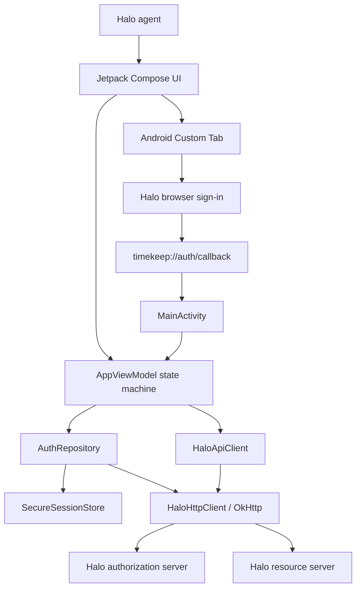
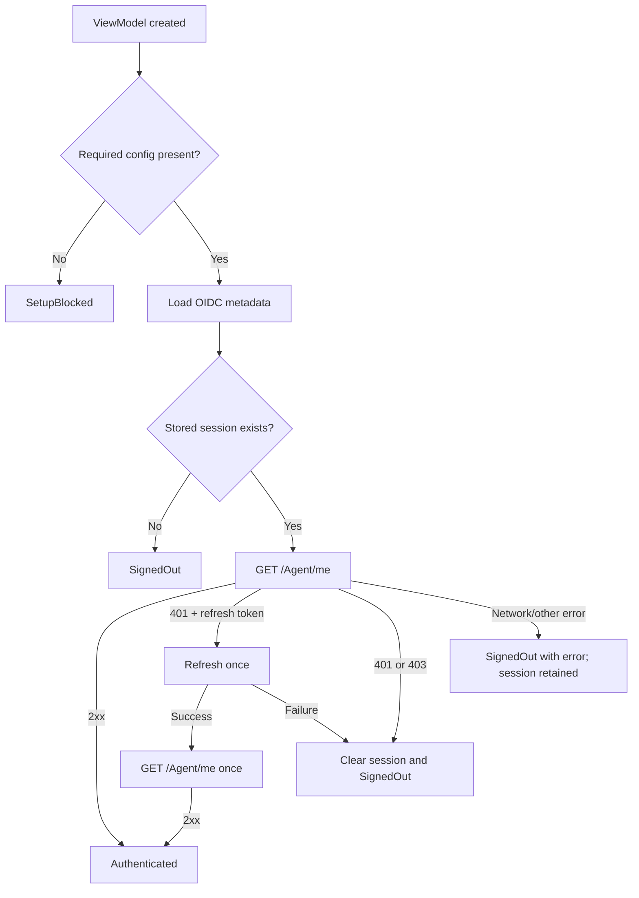
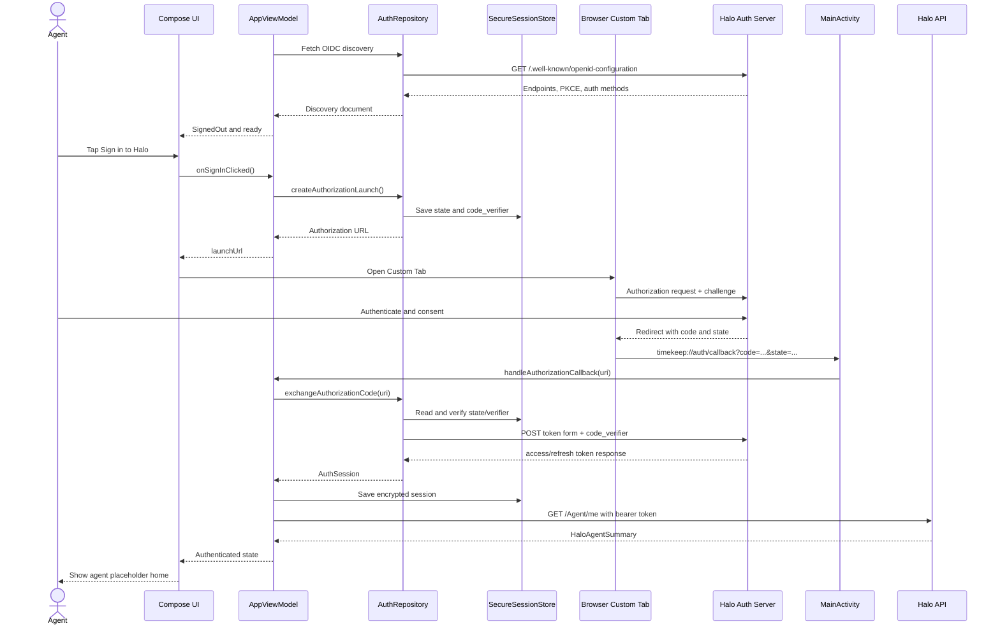
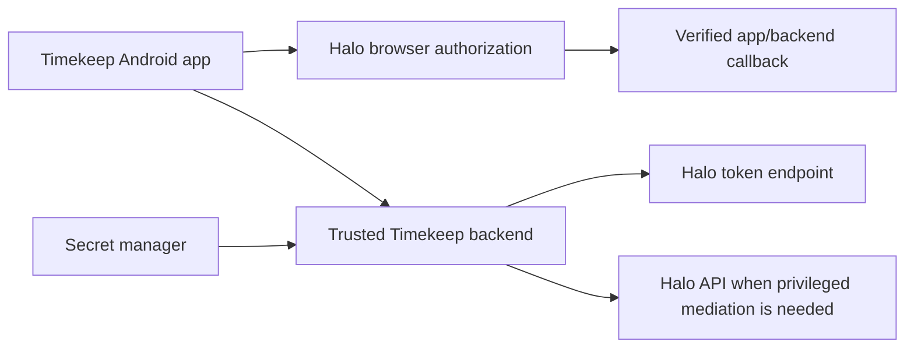

# Building Timekeep: From HaloITSM API to Android UI

> A complete, beginner-friendly reconstruction of the first Timekeep Android sprint
>
> Project: Timekeep Android auth shell
>
> Halo product: HaloITSM
>
> Environment used while building: Newforma DEV Sandbox
>
> Last verified: July 16, 2026

## Read this first

This document teaches the project as if we were rebuilding it together from an empty folder. It explains not only which files exist, but why they exist, how information moves through them, what happened on the network during login, how Android brought the browser back into the app, how the build was repaired, and how the resulting APK was installed on a real phone.

The working first sprint deliberately stops here:

1. Launch the Android app.
2. Check local configuration and any saved session.
3. Open Halo's sign-in page in a browser-based Custom Tab.
4. Receive an OAuth authorization code through `timekeep://auth/callback`.
5. Exchange the code for tokens.
6. Store the session in encrypted local storage.
7. Call `GET /api/Agent/me` with the access token.
8. Show the authenticated Halo agent on a small placeholder home screen.
9. Clear the local session when the agent signs out.

Camera scanning, asset search, device reassignment, device creation, and ticket actions are intentionally absent. Authentication is the foundation those features will rely on later.

### What "deployed" means in this guide

The app was successfully compiled into a debug APK, installed from Android Studio on a physical Android phone, and tested against the Halo sandbox. It was also committed to the Git repository's `dev` branch during the first implementation cycle. It has **not** been published to Google Play, deployed through enterprise mobile-device management, or hardened as a production release.

The verified debug artifact is generated at:

```text
app/build/outputs/apk/debug/app-debug.apk
```

### The most important security warning

The Halo sandbox currently advertises `client_secret_basic` and `client_secret_post` as its token endpoint authentication methods. That is why this prototype accepts `HALO_CLIENT_SECRET` from the developer's private Gradle properties and places it in the generated Android `BuildConfig` for sandbox testing.

That is **not a secure production architecture**. Anything packaged in an APK can ultimately be recovered by someone who controls a copy of that APK. Android's own security guidance warns that compiled application secrets can be found through reverse engineering. A production design should either use a true public native client that needs no shared secret or move the confidential code-to-token exchange behind a trusted backend. See [Android's security checklist](https://developer.android.com/privacy-and-security/security-tips), [hardcoded cryptographic secret guidance](https://developer.android.com/privacy-and-security/risks/hardcoded-cryptographic-secrets), and [OAuth 2.0 for Native Apps](https://www.rfc-editor.org/rfc/rfc8252).

Never commit the Halo client secret, access token, refresh token, or authorization code to Git. This guide never prints the real secret.

## Table of contents

1. [The mental model](#1-the-mental-model)
2. [Architecture at a glance](#2-architecture-at-a-glance)
3. [Tools and prerequisites](#3-tools-and-prerequisites)
4. [Discovering the real Halo tenant](#4-discovering-the-real-halo-tenant)
5. [Registering the Halo OAuth application](#5-registering-the-halo-oauth-application)
6. [Creating the Android project](#6-creating-the-android-project)
7. [Understanding the Gradle build](#7-understanding-the-gradle-build)
8. [Supplying environment configuration](#8-supplying-environment-configuration)
9. [Registering the OAuth callback in Android](#9-registering-the-oauth-callback-in-android)
10. [Building the shared data models](#10-building-the-shared-data-models)
11. [Building the HTTP and Halo API layer](#11-building-the-http-and-halo-api-layer)
12. [Implementing OIDC discovery](#12-implementing-oidc-discovery)
13. [Implementing PKCE and state](#13-implementing-pkce-and-state)
14. [Persisting the session](#14-persisting-the-session)
15. [Implementing the OAuth repository](#15-implementing-the-oauth-repository)
16. [Mapping the Halo agent response](#16-mapping-the-halo-agent-response)
17. [Wiring dependencies with AppContainer](#17-wiring-dependencies-with-appcontainer)
18. [Designing the state machine in AppViewModel](#18-designing-the-state-machine-in-appviewmodel)
19. [Receiving the callback in MainActivity](#19-receiving-the-callback-in-mainactivity)
20. [Building the Compose UI](#20-building-the-compose-ui)
21. [Tracing a complete sign-in](#21-tracing-a-complete-sign-in)
22. [Building and running the app](#22-building-and-running-the-app)
23. [Testing the authentication slice](#23-testing-the-authentication-slice)
24. [Every build problem we solved](#24-every-build-problem-we-solved)
25. [OAuth and runtime troubleshooting](#25-oauth-and-runtime-troubleshooting)
26. [Git and GitHub workflow](#26-git-and-github-workflow)
27. [Production-hardening roadmap](#27-production-hardening-roadmap)
28. [How to add asset features safely](#28-how-to-add-asset-features-safely)
29. [File-by-file reference](#29-file-by-file-reference)
30. [Rebuild checklist](#30-rebuild-checklist)
31. [Glossary](#31-glossary)
32. [Primary references](#32-primary-references)

## 1. The mental model

Before writing Kotlin, we need a clear picture of the systems involved.

### The four OAuth roles in this project

OAuth separates the user's password from the application that needs access. The app never asks the user to type a Halo password into a Timekeep screen. Instead, the user authenticates directly with Halo. This follows the model defined by the [OAuth 2.0 framework](https://www.rfc-editor.org/rfc/rfc6749).

| OAuth term | Timekeep meaning |
|---|---|
| Resource owner | The Halo agent signing in |
| Client | The Timekeep Android app |
| Authorization server | `https://newformaholdingsdev.haloitsm.com/auth` |
| Resource server | `https://newformaholdingsdev.haloitsm.com/api` |

The authorization server proves the user's identity and issues tokens. The resource server receives those tokens and serves protected Halo data.

### Authentication versus authorization

These words sound similar but mean different things:

- **Authentication** asks, "Who are you?"
- **Authorization** asks, "What are you allowed to do?"

Signing in successfully does not guarantee that every API call is permitted. Effective Halo access depends on the intersection of the signed-in agent's roles, team/customer access rules, the application's selected scopes, resource permissions, and modules enabled in the tenant. A `401 Unauthorized` usually indicates a missing, invalid, or expired authentication token. A `403 Forbidden` usually means the identity was recognized but does not have permission for that operation.

### OAuth is not the same as an API call

The app talks to two related services:

1. It talks to the **authorization server** to discover endpoints, open sign-in, exchange an authorization code, and refresh tokens.
2. It talks to the **resource server** to request actual Halo data such as the current agent.

The token endpoint returns credentials. `/Agent/me` returns business data.

### What is a token?

An access token is a short-lived credential that the app sends in an HTTP header:

```http
Authorization: Bearer {access_token}
```

A refresh token is a longer-lived credential used only with the authorization server to request a replacement access token. It must never be sent to `/Agent/me` or another resource endpoint. OAuth makes issuing refresh tokens optional; this app asks for `offline_access`, saves a refresh token when Halo returns one, and performs at most one refresh after a `401`.

### What is OpenID Connect?

OpenID Connect, commonly abbreviated OIDC, builds an identity layer on OAuth. One useful part is **discovery**: an authorization server publishes a JSON document at `/.well-known/openid-configuration`. The document tells clients where its authorization and token endpoints are and which capabilities it supports. The format is defined by [OpenID Connect Discovery 1.0](https://openid.net/specs/openid-connect-discovery-1_0.html).

Timekeep uses discovery but does not use an ID token as its source of agent identity. It establishes the authenticated application state by calling Halo's `GET /Agent/me` endpoint.

## 2. Architecture at a glance

The app uses a small layered architecture. Each layer has one main responsibility.



### Why layers help

Without layers, the button click could construct URLs, perform HTTP calls, parse JSON, write disk files, and choose screen colors all in one function. That would work for a tiny demonstration but become difficult to understand and test.

In this project:

- UI functions render state and forward user actions.
- `AppViewModel` coordinates the workflow and owns screen state.
- repositories and API clients perform data operations.
- `HaloHttpClient` handles HTTP mechanics.
- model classes carry data between layers.
- `SecureSessionStore` owns persistent authentication data.
- Gradle and `BuildConfig` provide environment settings.

### The project tree

```text
Timekeep-dev/
|-- app/
|   |-- build.gradle.kts
|   |-- proguard-rules.pro
|   `-- src/main/
|       |-- AndroidManifest.xml
|       |-- java/com/newforma/timekeep/
|       |   |-- auth/
|       |   |-- model/
|       |   |-- network/
|       |   |-- ui/
|       |   |-- AppContainer.kt
|       |   |-- AppUiState.kt
|       |   |-- AppViewModel.kt
|       |   |-- MainActivity.kt
|       |   `-- TimekeepApplication.kt
|       `-- res/values/
|           |-- strings.xml
|           `-- themes.xml
|-- docs/
|-- gradle/
|   |-- libs.versions.toml
|   `-- wrapper/
|-- build.gradle.kts
|-- gradle.properties
|-- gradlew
|-- gradlew.bat
`-- settings.gradle.kts
```

Each code folder contains a small `README.md` explaining its responsibility. This larger guide connects all of those local explanations into one end-to-end lesson.

## 3. Tools and prerequisites

### Knowledge prerequisites

You do not need to be an expert, but these ideas will make the guide easier:

- A variable stores a value.
- A function accepts inputs and produces behavior or a result.
- A class groups data and behavior.
- An interface describes operations without committing to one implementation.
- JSON is a text format for structured data.
- HTTP is the request/response protocol used by web APIs.
- Git records versions of files.

### Software prerequisites

- Windows 10 or 11
- Android Studio with its bundled Java runtime
- Android SDK Platform 36 for the versions pinned in this project
- Git
- Internet access to the Halo sandbox and dependency repositories
- A physical Android device running Android 9/API 28 or later, or a compatible emulator
- A Halo sandbox account that can sign in as an agent
- Halo administrator access to view or create the OAuth application

The project's `minSdk = 28` means Android will refuse to install it on devices older than Android 9. `targetSdk = 36` says the app was designed against Android API 36 behavior. `compileSdk = 36` tells the compiler which Android API definitions are available while building.

### Physical phone preparation

1. Open the phone's **Settings**.
2. Open **About phone**.
3. Tap **Build number** seven times to enable developer options.
4. Open **Developer options**.
5. Enable **USB debugging**.
6. Connect a data-capable USB cable.
7. Accept the computer's RSA debugging prompt on the phone.

Android's official guide explains both USB and wireless setup: [Run apps on a hardware device](https://developer.android.com/studio/run/device.html).

### Access prerequisites in Halo

The tenant administrator needs to be able to navigate to:

```text
Configuration > Integrations > Halo API
```

Halo's current [Creating API Applications guide](https://www.usehalo.com/guides/1823) identifies this page as the source for the tenant's resource server, authorization server, API documentation, and registered applications.

## 4. Discovering the real Halo tenant

### Why discovery came before coding

Halo publishes a shared platform API across HaloITSM, HaloPSA, and HaloCRM. Endpoints and fields can vary by product, tenant version, enabled modules, permissions, and local configuration. Therefore, code should be based on the target tenant's generated Swagger and observed responses, not an endpoint remembered from another Halo product.

This is the authority order used for Timekeep:

1. Newforma sandbox Swagger and observed sandbox behavior.
2. Current official Halo guides.
3. Halo's public unified Swagger for broad discovery.
4. Generic OAuth, OIDC, Android, Kotlin, Gradle, and OkHttp specifications/documentation.
5. Historical or cross-product examples only as clues.

### Tenant facts we verified

| Item | Verified value |
|---|---|
| Agent Portal | `https://newformaholdingsdev.haloitsm.com/` |
| Resource Server | `https://newformaholdingsdev.haloitsm.com/api` |
| Authorization Server | `https://newformaholdingsdev.haloitsm.com/auth` |
| Tenant ID | `newformaholdingsdev` |
| AuthInfo | `https://newformaholdingsdev.haloitsm.com/api/AuthInfo` |
| OIDC metadata | `https://newformaholdingsdev.haloitsm.com/auth/.well-known/openid-configuration` |
| Tenant Swagger JSON | `https://newformaholdingsdev.haloitsm.com/api/swagger/v2/swagger.json` |
| Authenticated bootstrap | `GET https://newformaholdingsdev.haloitsm.com/api/Agent/me` |

On July 16, 2026, `GET /api/AuthInfo` returned the authorization URL and tenant ID. The OIDC document advertised:

- authorization endpoint: `/auth/authorize`
- token endpoint: `/auth/token`
- end-session endpoint: `/auth/logout`
- revocation endpoint: `/auth/revoke`
- grant types including `authorization_code` and `refresh_token`
- PKCE method `S256`
- token authentication methods `client_secret_basic` and `client_secret_post`
- relevant scopes including `openid`, `profile`, `offline_access`, `read:users`, `read:assets`, and `edit:assets`

The tenant Swagger contained 927 paths and exposed `GET /Agent/me`. Its `/Agent/me` operation described a `200 OK` response but did **not** declare a detailed response schema or operation security metadata. This is why Timekeep parses the small set of fields it needs defensively instead of generating a rigid full agent class.

### How a student can repeat discovery

Use a browser for the first two public metadata endpoints:

```text
https://YOUR-TENANT.haloitsm.com/api/AuthInfo
https://YOUR-TENANT.haloitsm.com/auth/.well-known/openid-configuration
```

Then open:

```text
https://YOUR-TENANT.haloitsm.com/api/swagger
```

Search for `/Agent/me`. Record the exact path and method. Do not assume casing, scopes, or response fields are identical in a different tenant.

For future asset work, separately inspect `/Asset`, its query parameters, request schemas, response schemas, and permissions. The presence of `read:assets` or `edit:assets` in OIDC metadata means the authorization server recognizes the scope name; it does not prove that one particular application has been granted that scope or that every asset operation is enabled.

### Read-only validation first

The first authenticated call was intentionally `GET /Agent/me` because it is read-only, small, and directly proves that:

- the authorization code was exchanged successfully;
- the access token is acceptable to the resource server;
- the token represents a Halo agent;
- the application's scopes and the agent's effective permissions allow the call;
- JSON reached the Android app and could be rendered.

No asset was created or changed while validating authentication.

## 5. Registering the Halo OAuth application

### Halo administrator steps

1. Sign in to the sandbox as a Halo administrator.
2. Open **Configuration**.
3. Open **Integrations**.
4. Open **Halo API**.
5. Record the displayed resource server, authorization server, tenant, and documentation URL.
6. Select **View Applications**.
7. Create a new application. Do not modify Halo's preconfigured internal applications.
8. Give it a clear environment-specific name such as `Timekeep Android DEV`.
9. Enable the application.
10. Select **Authorisation Code (Native Application)**.
11. Configure the login as an agent/user-driven flow according to the tenant's available options.
12. Add only the scopes needed for the current slice.
13. Register the exact redirect URI `timekeep://auth/callback`.
14. Save the application.
15. Record the client ID.
16. Store the client secret privately for sandbox testing. Never place it in the repository, a Markdown guide, a ticket, or chat.

The registered sandbox client ID is:

```text
878f661c-9f8d-42a1-bf85-a0b0037c76c0
```

A client ID identifies an OAuth application and is not treated like a password. The client secret is confidential and is deliberately omitted.

### Scopes used by this sprint

The app's default request is:

```text
openid profile offline_access
```

- `openid` requests an OpenID Connect authentication flow.
- `profile` requests basic profile-related authorization.
- `offline_access` asks the server to issue a refresh token when policy permits it.

This exact sandbox registration and the test agent successfully completed `/Agent/me`. A new tenant must verify its own minimum scope set. Do not add `all`, `admin`, `read:assets`, or `edit:assets` until a feature actually needs them and its permission design has been reviewed.

### Why the redirect must match exactly

The authorization request contains `redirect_uri=timekeep://auth/callback`. The token request contains the same value. Halo's application registration must also contain that value. OAuth servers compare redirect URIs to prevent an authorization code from being sent to an attacker's location. The [OAuth framework](https://www.rfc-editor.org/rfc/rfc6749) requires registered redirect matching and binds an authorization code to the client and redirect URI.

The older Postman redirect, `https://oauth.pstmn.io/v1/callback`, was useful for desktop/Postman testing but could not return control to the Android app. The mobile registration had to include `timekeep://auth/callback`.

### A redirect URI limitation to understand

`timekeep://` is a custom/private URI scheme. It works because Android lets applications declare that they handle a scheme, host, and path. However, another installed app could also claim that scheme. [RFC 8252](https://www.rfc-editor.org/rfc/rfc8252) recommends reverse-domain private schemes controlled by the app publisher, and Android recommends verified HTTPS App Links when a controlled web domain is available.

PKCE reduces the value of an intercepted authorization code because the intercepting app does not possess the verifier. For production, prefer a collision-resistant reverse-domain scheme or a verified HTTPS App Link if Halo accepts it.

## 6. Creating the Android project

### Initial project choices

The project was created as an Android application with:

- Kotlin as the language
- Jetpack Compose for UI
- package/namespace `com.newforma.timekeep`
- application ID `com.newforma.timekeep`
- minimum Android API 28
- one application module named `app`
- Java/Kotlin bytecode target 17

### Why Kotlin

Kotlin is the main language recommended for modern Android development. It gives this project concise data classes, sealed interfaces for state, null-safety, coroutines for asynchronous work, and extension functions for small parsing helpers.

### Why Jetpack Compose

Compose is a declarative UI system. Instead of manually changing individual labels and hiding views, the app describes what the screen should look like for each `AppUiState`. When state changes, Compose recomposes the affected UI. See [State and Jetpack Compose](https://developer.android.com/develop/ui/compose/state).

### Why one activity

This auth shell is small enough for one `MainActivity`. It hosts the Compose UI and also receives the OAuth deep-link intent. The screens are not separate Android activities; they are different renderings selected by a sealed UI state.

### Root settings

`settings.gradle.kts` gives the project a name, includes `:app`, and declares repositories:

```kotlin
pluginManagement {
    repositories {
        google()
        mavenCentral()
        gradlePluginPortal()
    }
}

dependencyResolutionManagement {
    repositoriesMode.set(RepositoriesMode.FAIL_ON_PROJECT_REPOS)
    repositories {
        google()
        mavenCentral()
    }
}

rootProject.name = "timekeep-dev"
include(":app")
```

`google()` provides Android/Jetpack artifacts. `mavenCentral()` provides Kotlin, OkHttp, and many JVM libraries. `gradlePluginPortal()` supplies Gradle plugins.

The Foojay resolver plugin helps Gradle resolve compatible Java toolchains:

```kotlin
plugins {
    id("org.gradle.toolchains.foojay-resolver-convention") version "0.10.0"
}
```

### Root build script

The root `build.gradle.kts` declares plugin aliases without applying them to the root project:

```kotlin
plugins {
    alias(libs.plugins.android.application) apply false
    alias(libs.plugins.kotlin.android) apply false
    alias(libs.plugins.kotlin.compose) apply false
    alias(libs.plugins.kotlin.serialization) apply false
}
```

The `app` module applies the plugins it actually needs. Keeping plugin versions centralized prevents two modules from silently using different tool versions.

## 7. Understanding the Gradle build

### What Gradle does

Gradle is the build system. It resolves dependencies, compiles Kotlin, merges Android resources and manifests, packages bytecode and resources, signs debug builds, and produces an APK. Android Studio runs these Gradle tasks behind its buttons.

The Gradle Wrapper consists of `gradlew`, `gradlew.bat`, and `gradle/wrapper/*`. It pins Gradle 8.14.5 so a student does not need to install a matching global Gradle version. On Windows:

```powershell
.\gradlew.bat :app:assembleDebug
```

Android's [command-line build guide](https://developer.android.com/build/building-cmdline) documents the wrapper and `assembleDebug` task.

### Version catalog

`gradle/libs.versions.toml` centralizes library and plugin coordinates. Gradle automatically turns aliases such as `androidx-core-ktx` into type-safe Kotlin accessors such as `libs.androidx.core.ktx`. See the official [Gradle version catalog guide](https://docs.gradle.org/current/userguide/version_catalogs.html).

The project pins compatible versions instead of always taking the newest release. This became important when newer AndroidX versions required `compileSdk 37`, while the machine had SDK 36 installed.

Key dependency roles:

| Dependency | Why it exists |
|---|---|
| AndroidX Core KTX | Kotlin-friendly Android framework helpers |
| Lifecycle runtime/ViewModel | `ViewModel`, `viewModelScope`, lifecycle support |
| Activity Compose | Hosts Compose from `ComponentActivity` |
| Compose UI and Material 3 | Declarative controls, layout, theme, typography |
| AndroidX Browser | `CustomTabsIntent` for browser-based sign-in |
| Security Crypto | Current prototype's encrypted preferences and master key |
| Coroutines Android | Non-blocking orchestration and Android dispatchers |
| Kotlin serialization JSON | Decode OIDC/token JSON and persist model JSON |
| OkHttp | HTTPS requests, form posts, headers, timeouts |
| OkHttp logging interceptor | Basic debug request/response metadata |

`datastore-preferences` is present as preparation for more modern persistence but is not used by the current code. That is a useful reminder: a Gradle dependency alone does nothing until code calls it.

### Compose BOM

The Compose Bill of Materials aligns compatible versions of Compose libraries. The module declares the platform once:

```kotlin
implementation(platform(libs.androidx.compose.bom))
```

It then omits individual versions for Compose UI, tooling preview, and Material 3. Google's [Compose BOM mapping](https://developer.android.com/develop/ui/compose/bom/bom-mapping) shows which versions a BOM release selects.

### Module Android configuration

Important `app/build.gradle.kts` settings are:

```kotlin
android {
    namespace = "com.newforma.timekeep"
    compileSdk = 36

    defaultConfig {
        applicationId = "com.newforma.timekeep"
        minSdk = 28
        targetSdk = 36
        versionCode = 1
        versionName = "0.1.0"
    }
}
```

`versionCode` is an integer Android and app stores use to order releases. `versionName` is the human-facing release label.

### Build types

The module has `debug` and `release` build types. Debug is developer-oriented and Android Studio signs it with a debug key. Release is the starting point for production packaging, but this project does not yet define a private release signing configuration and currently leaves minification disabled.

```kotlin
getByName("debug") {
    isMinifyEnabled = false
}

getByName("release") {
    isMinifyEnabled = false
    proguardFiles(
        getDefaultProguardFile("proguard-android-optimize.txt"),
        "proguard-rules.pro",
    )
}
```

Production work should test an optimized, signed release build. Android requires installable APKs to be signed; see [Prepare your app for release](https://developer.android.com/studio/publish/preparing) and [Sign your app](https://developer.android.com/studio/publish/app-signing).

### Java and Kotlin target

```kotlin
compileOptions {
    sourceCompatibility = JavaVersion.VERSION_17
    targetCompatibility = JavaVersion.VERSION_17
}

kotlinOptions {
    jvmTarget = "17"
}
```

This tells the Java and Kotlin compilers to produce compatible JVM bytecode. The current Kotlin plugin warns that `kotlinOptions` is deprecated in favor of the newer compiler options DSL; it still builds, but migration belongs in maintenance work.

### Build memory

The repository's `gradle.properties` increases Gradle and Kotlin daemon memory:

```properties
org.gradle.jvmargs=-Xmx2048m -XX:MaxMetaspaceSize=512m -Dfile.encoding=UTF-8
kotlin.daemon.jvmargs=-Xmx1024m
android.useAndroidX=true
```

The original daemon was limited to a 512 MiB heap and spent most of its time garbage collecting. Raising the heap to 2 GiB prevented the build process from thrashing. This is build-machine memory, not memory granted to the Android app on the phone.

### Packaging exclusions

Some dependencies contained the same metadata resource. Android packaging cannot include two files at the same APK path, so the build excludes non-runtime metadata:

```kotlin
packaging {
    resources {
        excludes += "/META-INF/{AL2.0,LGPL2.1}"
        excludes += "META-INF/versions/9/OSGI-INF/MANIFEST.MF"
    }
}
```

These exclusions do not remove application code. They resolve duplicate license/manifest resources contributed by libraries.

## 8. Supplying environment configuration

### Configuration belongs outside source code

Different environments have different Halo URLs, tenant IDs, app registrations, and scopes. The build reads each setting from a Gradle property first, then an environment variable, then a project default:

```kotlin
fun Project.gradleOrEnv(name: String, default: String = ""): String {
    return providers.gradleProperty(name).orNull?.takeIf { it.isNotBlank() }
        ?: providers.environmentVariable(name).orNull?.takeIf { it.isNotBlank() }
        ?: default
}
```

This priority lets a developer keep private values in their user profile while CI can inject environment variables.

### User Gradle properties location

On this Windows machine, the file is:

```text
C:\Users\AdrianBaloi\.gradle\gradle.properties
```

The portable Windows form is:

```text
%USERPROFILE%\.gradle\gradle.properties
```

The sandbox configuration is:

```properties
HALO_CLIENT_ID=878f661c-9f8d-42a1-bf85-a0b0037c76c0
HALO_CLIENT_SECRET=YOUR_SANDBOX_SECRET
HALO_REDIRECT_URI=timekeep://auth/callback
HALO_SCOPES=openid profile offline_access

HALO_ENVIRONMENT_LABEL=Newforma DEV Sandbox
HALO_RESOURCE_SERVER_URL=https://newformaholdingsdev.haloitsm.com/api
HALO_AUTH_SERVER_URL=https://newformaholdingsdev.haloitsm.com/auth
HALO_TENANT_ID=newformaholdingsdev
HALO_USE_PKCE=true
HALO_INCLUDE_TENANT_ON_TOKEN_REQUESTS=true
```

Do not place quotes around ordinary property values. Do not add the secret to the repository's `gradle.properties`.

### How values become Kotlin constants

The module uses `buildConfigField` to generate constants such as:

```kotlin
BuildConfig.HALO_AUTH_SERVER_URL
BuildConfig.HALO_CLIENT_ID
BuildConfig.HALO_REDIRECT_URI
```

`HaloEnvironmentConfig.fromBuildConfig()` trims and normalizes them into a single runtime data object. Base URLs lose a trailing slash so code can safely append `/Agent/me` without creating accidental double slashes.

`missingFields()` validates required non-secret fields. The client secret is not treated as universally required at this stage because the app first reads OIDC metadata to see which token authentication methods the current tenant advertises.

### Why BuildConfig does not make a secret safe

`BuildConfig` prevents the secret from being committed when the input comes from user Gradle properties, but the generated constant is still compiled into the APK. Source-control hygiene and runtime secret security are different problems:

- User Gradle properties keep the secret out of Git.
- They do **not** keep the secret out of a built APK.

That distinction is the reason this mechanism is acceptable only for sandbox testing.

## 9. Registering the OAuth callback in Android

### What a deep link does

After Halo finishes sign-in in the browser, it navigates to a URL beginning with `timekeep://`. A normal website cannot render that scheme. Android inspects every installed app's manifest to find an activity that registered a matching intent filter, then sends the URI to that activity.

Android's [deep-link documentation](https://developer.android.com/training/app-links/create-deeplinks) explains that a browser-reachable filter needs `VIEW`, `DEFAULT`, and `BROWSABLE` plus matching URI data.

### Passing Gradle values into the manifest

`app/build.gradle.kts` parses the configured redirect URI:

```kotlin
val redirectUriValue = project.gradleOrEnv(
    "HALO_REDIRECT_URI",
    "timekeep://auth/callback",
)
val redirectUri = URI(redirectUriValue)
val redirectScheme = redirectUri.scheme ?: "timekeep"
val redirectHost = redirectUri.host ?: "auth"
val redirectPath = redirectUri.path?.ifBlank { "/callback" } ?: "/callback"
```

For `timekeep://auth/callback`, the parsed values are:

| Part | Value |
|---|---|
| Scheme | `timekeep` |
| Host | `auth` |
| Path | `/callback` |

Those values become manifest placeholders:

```kotlin
manifestPlaceholders += mapOf(
    "haloRedirectScheme" to redirectScheme,
    "haloRedirectHost" to redirectHost,
    "haloRedirectPath" to redirectPath,
)
```

### Manifest declaration

`AndroidManifest.xml` includes internet access and two intent filters on `MainActivity`:

```xml
<uses-permission android:name="android.permission.INTERNET" />

<activity
    android:name=".MainActivity"
    android:exported="true"
    android:launchMode="singleTask">

    <intent-filter>
        <action android:name="android.intent.action.MAIN" />
        <category android:name="android.intent.category.LAUNCHER" />
    </intent-filter>

    <intent-filter>
        <action android:name="android.intent.action.VIEW" />
        <category android:name="android.intent.category.DEFAULT" />
        <category android:name="android.intent.category.BROWSABLE" />
        <data
            android:scheme="${haloRedirectScheme}"
            android:host="${haloRedirectHost}"
            android:path="${haloRedirectPath}" />
    </intent-filter>
</activity>
```

The launcher filter creates the normal app icon entry. The view filter receives the OAuth callback.

`android:exported="true"` is required because the browser is outside the app and must be able to launch the activity. This does not mean callback data is trusted: `MainActivity` checks the URI and `AuthRepository` validates OAuth state before accepting the code.

`android:launchMode="singleTask"` asks Android to reuse the existing `MainActivity` when possible. If the activity already exists, Android calls `onNewIntent()` instead of creating a second activity. That keeps one ViewModel/state machine in charge of the sign-in completion.

### Other manifest security settings

The application declaration includes:

```xml
android:allowBackup="false"
android:fullBackupContent="false"
android:usesCleartextTraffic="false"
```

Disabling backup reduces the chance that stored authentication material is copied into cloud backup. Android notes that device-to-device transfer behavior can still vary on newer versions, so production should also use modern data extraction rules where appropriate. Disallowing cleartext traffic protects against accidentally replacing an HTTPS endpoint with unencrypted HTTP. See the official [`<application>` manifest reference](https://developer.android.com/guide/topics/manifest/application-element) and [Auto Backup guidance](https://developer.android.com/identity/data/autobackup).

## 10. Building the shared data models

Models give meaningful names and types to the values crossing layers.

### AuthSession

```kotlin
@Serializable
data class AuthSession(
    val accessToken: String,
    val refreshToken: String?,
    val expiresAtEpochSeconds: Long,
    val tokenType: String,
    val scope: String?,
)
```

- `accessToken` authorizes Halo API calls.
- `refreshToken` may be absent because OAuth servers are not required to issue one.
- `expiresAtEpochSeconds` converts a relative lifetime such as 3600 seconds into an absolute timestamp.
- `tokenType` is usually `Bearer`.
- `scope` records what the token response says was granted.

The class is `@Serializable` so Kotlin serialization can convert it to JSON for storage and back into an object. [Kotlin serialization](https://kotlinlang.org/docs/serialization.html) generates this mapping at compile time.

`expiresSoon()` compares the saved expiry against the current time plus a 60-second safety margin. The method exists but the current ViewModel does not proactively call it; the implemented recovery path waits for `/Agent/me` to return `401`, then refreshes once. Production should decide whether to refresh proactively using this method.

### PendingAuthorizationRequest

```kotlin
@Serializable
data class PendingAuthorizationRequest(
    val state: String,
    val codeVerifier: String?,
    val createdAtEpochSeconds: Long,
)
```

The app must remember values generated before launching the browser so it can compare/use them after Android receives the callback. The process can be backgrounded while the browser is open, so storing these values only in a normal Kotlin variable would be fragile.

- `state` binds the callback to the request the app initiated.
- `codeVerifier` proves that the app exchanging the code is the app that began the PKCE request.
- `createdAtEpochSeconds` supports future expiry checks. The current code saves it but does not yet reject old pending requests based on age.

### AuthorizationLaunch

```kotlin
data class AuthorizationLaunch(val url: String)
```

This tiny wrapper distinguishes a URL intended for the browser from arbitrary strings. It also leaves room for future browser-launch metadata.

### HaloAgentSummary

```kotlin
data class HaloAgentSummary(
    val id: String?,
    val displayName: String,
    val email: String?,
    val jobTitle: String?,
    val initials: String?,
    val primaryTeam: String?,
)
```

The UI needs only a human-readable identity, not every property from Halo's full agent record. Small models are easier to understand and less sensitive to unrelated server changes.

Most fields are nullable because the tenant Swagger does not specify the `/Agent/me` response and agents may not have every profile field populated. `displayName` is required because the UI always needs something to show.

## 11. Building the HTTP and Halo API layer

### Why use an HTTP client library

Android provides low-level networking APIs, but OkHttp simplifies HTTPS connections, timeouts, request bodies, headers, response closing, and connection reuse. The official [OkHttp recipes](https://square.github.io/okhttp/recipes/) demonstrate the same `newCall(request).execute().use { ... }` pattern.

### Configuring OkHttp

`AppContainer` creates one long-lived client:

```kotlin
private val okHttpClient: OkHttpClient = OkHttpClient.Builder()
    .connectTimeout(20, TimeUnit.SECONDS)
    .readTimeout(20, TimeUnit.SECONDS)
    .writeTimeout(20, TimeUnit.SECONDS)
    .apply {
        val logging = HttpLoggingInterceptor().apply {
            level = if (BuildConfig.DEBUG) {
                HttpLoggingInterceptor.Level.BASIC
            } else {
                HttpLoggingInterceptor.Level.NONE
            }
        }
        addInterceptor(logging)
    }
    .build()
```

One client reuses connections and other internal resources. Twenty-second timeouts stop a failed network operation from waiting forever. Debug builds log basic request/response lines, while release builds log nothing through this interceptor.

`BASIC` was chosen instead of `BODY` because token form bodies and JSON responses can contain credentials. Even basic logs should be treated as sensitive operational data because URLs and timing can reveal environment information.

### Configuring JSON

```kotlin
val json: Json = Json {
    ignoreUnknownKeys = true
    explicitNulls = false
}
```

`ignoreUnknownKeys = true` means Halo may add properties without breaking deserialization of the few fields Timekeep understands. This behavior is documented in the [Kotlin serialization API](https://kotlinlang.org/api/kotlinx.serialization/kotlinx-serialization-json/kotlinx.serialization.json/-json-builder/ignore-unknown-keys.html).

### The generic HaloHttpClient

`HaloHttpClient` exposes two operations needed by this sprint:

```kotlin
suspend fun getJson(url: String, bearerToken: String? = null): JsonElement
suspend fun postForm(
    url: String,
    form: Map<String, String>,
    bearerToken: String? = null,
): JsonObject
```

The GET operation constructs this kind of request:

```http
GET {url}
Accept: application/json
Authorization: Bearer {access_token}   # only when supplied
```

The form POST uses OkHttp's `FormBody`, which generates the OAuth token endpoint's expected `application/x-www-form-urlencoded` request format.

### Keeping network work off the main thread

`executeJson()` is a suspending function and runs blocking OkHttp work on `Dispatchers.IO`:

```kotlin
private suspend fun executeJson(request: Request): JsonElement =
    withContext(Dispatchers.IO) {
        okHttpClient.newCall(request).execute().use { response ->
            // Parse response here.
        }
    }
```

The Android main thread draws the UI and processes input. Blocking it with a network call would freeze the app. Kotlin coroutines let the function suspend while the I/O dispatcher does the blocking work. The [Kotlin coroutines guide](https://kotlinlang.org/docs/coroutines-guide.html) explains suspending functions, dispatchers, and structured concurrency.

### Always closing responses

The `.use { response -> ... }` block closes the OkHttp response even when parsing or status handling throws an exception. Closing releases sockets and other resources back to the client.

### Error normalization

For a non-2xx response, the client throws:

```kotlin
class ApiException(
    val statusCode: Int,
    val responseBody: String?,
) : IOException("Halo returned HTTP $statusCode")
```

Higher layers can distinguish `401` from `403` or a `5xx` without knowing OkHttp's response type. The raw body is available for a short user-facing diagnostic, but production telemetry should redact sensitive content.

### HaloApiClient

The API-specific class is intentionally tiny:

```kotlin
suspend fun getCurrentAgent(accessToken: String): HaloAgentSummary {
    val payload = httpClient.getJson(
        url = "${config.resourceServerUrl}/Agent/me",
        bearerToken = accessToken,
    )
    return payload.jsonObject.toHaloAgentSummary()
}
```

This separation matters. `HaloHttpClient` knows HTTP. `HaloApiClient` knows Halo routes and domain results. Future methods such as asset lookup should live in API-specific clients rather than the generic transport class.

### Exact authenticated request

With the sandbox configuration, the request is conceptually:

```http
GET /api/Agent/me HTTP/1.1
Host: newformaholdingsdev.haloitsm.com
Accept: application/json
Authorization: Bearer {access_token}
```

The working app never sends the client secret to `/Agent/me`. That secret is used only to authenticate the OAuth client at the token endpoint in this sandbox design.

## 12. Implementing OIDC discovery

### The discovery model

`OidcDiscoveryDocument` maps Halo's snake-case JSON keys:

```kotlin
@Serializable
data class OidcDiscoveryDocument(
    val issuer: String = "",
    val authorization_endpoint: String = "",
    val token_endpoint: String = "",
    val end_session_endpoint: String? = null,
    val revocation_endpoint: String? = null,
    val code_challenge_methods_supported: List<String> = emptyList(),
    val token_endpoint_auth_methods_supported: List<String> = emptyList(),
    val scopes_supported: List<String> = emptyList(),
)
```

Default values make parsing tolerant if an optional field is absent. Computed properties give the rest of the Kotlin code idiomatic names:

```kotlin
val pkceS256Supported: Boolean
    get() = code_challenge_methods_supported.any {
        it.equals("S256", ignoreCase = true)
    }
```

### Fetching metadata

`AuthRepository.fetchDiscovery()` requests:

```text
{HALO_AUTH_SERVER_URL}/.well-known/openid-configuration
```

It validates that the two endpoints essential to this flow are nonblank:

```kotlin
require(document.authorizationEndpoint.isNotBlank())
require(document.tokenEndpoint.isNotBlank())
```

The repository caches a successfully decoded document in memory. Normal bootstrap can reuse it; the Retry button passes `forceRefresh = true` to re-fetch metadata.

### Why discover instead of hardcoding

Hardcoding `/auth/authorize` and `/auth/token` would happen to match this tenant today, but discovery is more resilient and makes supported behavior explicit. The app can also show whether PKCE and secretless token authentication are advertised before sign-in begins.

### What tokenNeedsClientSecret means

```kotlin
val tokenNeedsClientSecret: Boolean
    get() = token_endpoint_auth_methods_supported.isNotEmpty() &&
        token_endpoint_auth_methods_supported.none {
            it.equals("none", ignoreCase = true)
        }
```

The live sandbox list contains `client_secret_basic` and `client_secret_post`, with no `none`, so this property is `true`. The UI blocks sign-in if metadata requires a secret and sandbox configuration has not supplied one.

This is capability detection, not proof that embedding a secret is secure. It simply prevents a token request that the current server metadata says cannot succeed.

### Production validation still missing

The current code trusts metadata returned from the configured HTTPS auth server but does not compare `issuer` against an exact configured expected value. Production hardening should validate the issuer and permitted endpoint hosts so a configuration mistake cannot direct credentials to an unexpected server.

## 13. Implementing PKCE and state

### The problem PKCE solves

Custom URI schemes can be claimed by another app. If a malicious app intercepts an OAuth authorization code, PKCE prevents it from exchanging that code unless it also has the verifier generated by the legitimate app.

[RFC 7636](https://www.rfc-editor.org/rfc/rfc7636) defines the sequence:

1. The client generates a random `code_verifier`.
2. It hashes the verifier into a `code_challenge`.
3. It sends the challenge with the authorization request.
4. It later sends the original verifier with the token request.
5. The server hashes the verifier and compares it with the stored challenge.

### Generating secure random values

`PkceUtil` uses Java's cryptographic `SecureRandom`, not a predictable pseudo-random helper:

```kotlin
private val secureRandom = SecureRandom()

fun generateCodeVerifier(): String = base64Url(randomBytes(32))
fun randomState(): String = base64Url(randomBytes(24))
```

The byte arrays are Base64 URL encoded without padding or line breaks:

```kotlin
Base64.encodeToString(
    bytes,
    Base64.URL_SAFE or Base64.NO_PADDING or Base64.NO_WRAP,
)
```

URL-safe Base64 substitutes characters that would otherwise need special escaping in a URL.

### Creating the S256 challenge

```kotlin
fun generateCodeChallenge(verifier: String): String {
    val digest = MessageDigest.getInstance("SHA-256")
        .digest(verifier.toByteArray(Charsets.US_ASCII))
    return base64Url(digest)
}
```

Mathematically:

```text
code_challenge = BASE64URL(SHA256(ASCII(code_verifier)))
```

The verifier is secret for one sign-in attempt. The challenge can be sent in the browser URL.

### Why state is separate from PKCE

PKCE protects code redemption. `state` protects the callback/request relationship and is the standard OAuth defense against cross-site request forgery at the redirect endpoint.

The app generates state before opening the browser, stores it, and requires the callback's state to be exactly equal. If it differs, the pending authorization is cleared and code exchange stops. The OAuth specification recommends a non-guessable state value and exact comparison.

### When PKCE is enabled

The app uses PKCE only when both local configuration enables it and OIDC metadata advertises `S256`:

```kotlin
val codeVerifier = if (config.usePkce && discovery.pkceS256Supported) {
    PkceUtil.generateCodeVerifier()
} else {
    null
}
```

For a native app, PKCE should be considered required. [OAuth 2.0 for Native Apps](https://www.rfc-editor.org/rfc/rfc8252) requires public native clients to implement it and recommends external browser user-agents instead of embedded WebViews.

## 14. Persisting the session

### Why an interface exists

```kotlin
interface SessionStore {
    fun readSession(): AuthSession?
    fun writeSession(session: AuthSession)
    fun clearSession()
    fun readPendingAuthorization(): PendingAuthorizationRequest?
    fun writePendingAuthorization(request: PendingAuthorizationRequest)
    fun clearPendingAuthorization()
    fun clearAll()
}
```

The rest of the app depends on behavior, not one storage technology. A test could provide an in-memory implementation. A later release can replace the deprecated encrypted preferences implementation without rewriting the auth repository.

### Current encrypted implementation

`SecureSessionStore` creates a 256-bit AES-GCM master key through Android Security Crypto and uses encrypted shared preferences:

```kotlin
private val masterKey = MasterKey.Builder(context)
    .setKeyScheme(MasterKey.KeyScheme.AES256_GCM)
    .build()
```

Preference keys use AES-256-SIV and values use AES-256-GCM. The serialized session and pending request are not saved as readable plaintext in ordinary preferences.

Android's [Keystore system](https://developer.android.com/privacy-and-security/keystore) is designed to make key material harder to extract and can keep key operations outside the application process or in secure hardware when supported.

### Encoding and decoding

Writing a session:

```kotlin
preferences.edit {
    putString(KEY_SESSION, json.encodeToString(session))
}
```

Reading catches malformed or obsolete JSON and returns `null` instead of crashing startup:

```kotlin
private inline fun <reified T> decode(key: String): T? {
    val raw = preferences.getString(key, null) ?: return null
    return runCatching { json.decodeFromString<T>(raw) }.getOrNull()
}
```

### Sign-out behavior

`clearAll()` removes both the current session and any unfinished authorization request. This is local sign-out. It does not call Halo's logout or revocation endpoints, so the browser may still have a Halo cookie and the server may still recognize previously issued tokens until expiry or revocation.

### Current API deprecation

`EncryptedSharedPreferences` and `MasterKey` are deprecated in AndroidX Security Crypto 1.1.0. The [Android API reference](https://developer.android.com/reference/androidx/security/crypto/EncryptedSharedPreferences) explicitly marks the class deprecated. It still works for this prototype, but a production migration should use a maintained storage design, such as app-private storage encrypted with a key managed directly through Android Keystore, with carefully defined backup and key-loss behavior.

Encryption at rest protects against some storage attacks. It does not make a shared OAuth client secret safe inside the APK, because that secret has to be recoverable by the running app before any per-device storage exists.

## 15. Implementing the OAuth repository

`AuthRepository` is the protocol center of the app. It does not choose screens. It knows how to perform discovery, construct the authorization request, validate a callback, exchange a code, and refresh a session.

### Step 1: create a pending request

`createAuthorizationLaunch()` generates state and, when supported, a code verifier. It saves both **before** returning the browser URL. Saving first avoids a race where the callback arrives but local verification material was never persisted.

### Step 2: construct the authorization URL

The repository uses Android's `Uri.Builder` so parameters are encoded safely:

```kotlin
val request = Uri.parse(discovery.authorizationEndpoint).buildUpon()
    .appendQueryParameter("client_id", config.clientId)
    .appendQueryParameter("response_type", "code")
    .appendQueryParameter("redirect_uri", config.redirectUri)
    .appendQueryParameter("scope", config.scopeList.joinToString(" "))
    .appendQueryParameter("state", state)
    .apply {
        if (codeVerifier != null) {
            appendQueryParameter("code_challenge_method", "S256")
            appendQueryParameter(
                "code_challenge",
                PkceUtil.generateCodeChallenge(codeVerifier),
            )
        }
    }
    .build()
    .toString()
```

The conceptual request is:

```http
GET /auth/authorize?
    client_id=878f661c-9f8d-42a1-bf85-a0b0037c76c0&
    response_type=code&
    redirect_uri=timekeep%3A%2F%2Fauth%2Fcallback&
    scope=openid%20profile%20offline_access&
    state={random_state}&
    code_challenge_method=S256&
    code_challenge={derived_challenge}
```

The app sends no Halo username or password. The browser handles user authentication directly with Halo.

### Step 3: launch an external browser context

The UI receives `AuthorizationLaunch.url` and opens an Android Custom Tab. This follows native OAuth best practice: the external browser owns its cookies, password manager, MFA, and security context. Android explains that [Custom Tabs](https://developer.android.com/develop/ui/views/layout/webapps/overview-of-android-custom-tabs) use the user's preferred browser engine and shared browser state.

### Step 4: inspect callback errors

When Halo redirects back, the repository first looks for standard OAuth error parameters:

```kotlin
val error = callbackUri.getQueryParameter("error")
val description = callbackUri.getQueryParameter("error_description")
```

If Halo reports denial or another authorization error, the app clears the pending request and throws a controlled failure.

### Step 5: verify state

```kotlin
val pending = sessionStore.readPendingAuthorization()
    ?: throw IllegalStateException("No pending Halo authorization state was found.")

val returnedState = callbackUri.getQueryParameter("state")
if (returnedState != pending.state) {
    sessionStore.clearPendingAuthorization()
    throw IllegalStateException("The Halo auth callback state did not match...")
}
```

No pending request means the callback was unsolicited, stale, or local state was lost. A state mismatch is never ignored.

### Step 6: extract the one-time code

```kotlin
val code = callbackUri.getQueryParameter("code")
    ?: throw IllegalStateException("Halo did not return an authorization code.")
```

An authorization code is short-lived and single-use. It is not the access token and is not sent to `/Agent/me`.

### Step 7: exchange the code

The form contains:

```kotlin
val body = linkedMapOf(
    "grant_type" to "authorization_code",
    "client_id" to config.clientId,
    "code" to code,
    "redirect_uri" to config.redirectUri,
)
pending.codeVerifier?.let { body["code_verifier"] = it }
appendClientSecretIfRequired(discovery, body)
```

For this sandbox, `appendClientSecretIfRequired()` adds `client_secret` to the form, using the advertised `client_secret_post` approach. Although metadata also advertises `client_secret_basic`, this implementation does not currently construct HTTP Basic client authentication.

When configured, `buildTokenUrl()` appends the tenant query parameter:

```text
https://newformaholdingsdev.haloitsm.com/auth/token?tenant=newformaholdingsdev
```

Conceptual request:

```http
POST /auth/token?tenant=newformaholdingsdev
Content-Type: application/x-www-form-urlencoded
Accept: application/json

grant_type=authorization_code&
client_id={client_id}&
client_secret={sandbox_secret}&
code={authorization_code}&
redirect_uri=timekeep%3A%2F%2Fauth%2Fcallback&
code_verifier={original_random_verifier}
```

### Step 8: normalize the token response

The private response model uses OAuth's JSON names:

```kotlin
@Serializable
private data class TokenResponse(
    val access_token: String = "",
    val token_type: String = "Bearer",
    val expires_in: Long = 0,
    val refresh_token: String? = null,
    val scope: String? = null,
)
```

`toSession()` calculates an absolute expiry:

```text
expiresAtEpochSeconds = currentEpochSeconds + expires_in
```

The current model does not validate that `access_token` is nonblank or consume/validate an OIDC `id_token`. The subsequent `/Agent/me` call acts as the practical token and agent validation gate. Production should still add stricter token-response validation.

The pending request is cleared after a successful token response, and the ViewModel writes the resulting session.

### Refresh flow

The refresh form is:

```kotlin
val body = linkedMapOf(
    "grant_type" to "refresh_token",
    "client_id" to config.clientId,
    "refresh_token" to refreshToken,
)
```

The sandbox secret is added under the same rule. If Halo rotates refresh tokens, the new response value replaces the old one. If the response omits a new refresh token, `toSession(previousRefreshToken)` preserves the existing one.

The repository itself does not loop. `AppViewModel` decides to call refresh only once after one `401`, then validates `/Agent/me` once more.

## 16. Mapping the Halo agent response

### Why manual defensive parsing was used

The tenant Swagger confirms the route but does not describe the response body. A rigid generated schema would be invented rather than evidence-based. `JsonParsing.kt` instead accepts a `JsonObject` and extracts only known useful candidates.

### Display-name fallback chain

```kotlin
val displayName = stringValue("name")
    ?: listOfNotNull(stringValue("firstname"), stringValue("surname"))
        .joinToString(" ")
        .ifBlank { null }
    ?: stringValue("email")
    ?: "Authenticated agent"
```

The `?:` Elvis operator means "use the value on the left unless it is null." The fallback order ensures the screen always has a display name.

### Other tolerant mappings

- Email tries `email`, then `googleemail`.
- Primary team tries the first object in `teams`, then a singular `team` property.
- A nested object can display its `name`, `label`, or `text`.
- Agent ID accepts a primitive and converts it to text, so numeric and string IDs both work.

Unknown fields are ignored. Missing optional fields simply do not render in the card.

### The tradeoff

Defensive parsing keeps the prototype working across a loosely specified response, but it can also hide a breaking semantic change. Production should capture a sanitized real response contract, add parser tests, and alert when expected identity fields disappear.

## 17. Wiring dependencies with AppContainer

### What dependency injection means

A class has a dependency when it needs another object to do its work. `AuthRepository` depends on configuration, storage, HTTP, and JSON. Creating those dependencies inside every method would duplicate state and make testing difficult.

`AppContainer` is a small manual dependency-injection container:

```kotlin
class AppContainer(context: Context) {
    val json = Json { ... }
    val config = HaloEnvironmentConfig.fromBuildConfig()
    private val okHttpClient = OkHttpClient.Builder().build()
    val sessionStore = SecureSessionStore(context.applicationContext, json)
    val httpClient = HaloHttpClient(json, okHttpClient)
    val authRepository = AuthRepository(config, sessionStore, httpClient, json)
    val haloApiClient = HaloApiClient(config, httpClient)
}
```

The construction order follows dependency order. For example, `HaloApiClient` can be created only after `config` and `httpClient` exist.

### Application lifetime

`TimekeepApplication` creates the container once:

```kotlin
class TimekeepApplication : Application() {
    lateinit var container: AppContainer
        private set

    override fun onCreate() {
        super.onCreate()
        container = AppContainer(applicationContext)
    }
}
```

The manifest registers `.TimekeepApplication`, so Android instantiates it before `MainActivity`. Long-lived objects such as OkHttp and the session store are shared instead of rebuilt during every Compose recomposition.

### Why applicationContext is used

The container outlives an activity. Holding an activity context inside it could prevent a destroyed activity from being garbage collected. `applicationContext` has the same lifetime as the app process and is suitable for persistent storage.

### When to use a framework later

Manual injection is clear and sufficient for this small project. As the app grows to multiple feature modules, test graphs, and environment-specific implementations, a framework such as Hilt may reduce boilerplate. A framework should solve actual complexity, not be added before the team understands the object graph.

## 18. Designing the state machine in AppViewModel

### Why model screens as states

Authentication is not one Boolean. During startup the app may be loading metadata, blocked by missing configuration, signed out and ready, finishing a callback, validating an old token, refreshing, authenticated, or recovering from an error.

`AppUiState` is a sealed interface, meaning every allowed state type is known to the compiler:

```kotlin
sealed interface AppUiState {
    data class SetupBlocked(...) : AppUiState
    data class SignedOut(...) : AppUiState
    data class Loading(...) : AppUiState
    data class Authenticated(...) : AppUiState
}
```

This lets the UI use an exhaustive `when`. Adding a new state later forces the compiler to show every place that must handle it.

### State responsibilities

| State | Meaning | Important data |
|---|---|---|
| `Loading` | Work is in progress | Human-readable title and detail |
| `SetupBlocked` | Required local config is missing | Missing property names |
| `SignedOut` | The app is not authenticated | Discovery readiness, PKCE support, token auth methods, message |
| `Authenticated` | `/Agent/me` succeeded | Environment, tenant, agent summary, optional status |

The application never enters `Authenticated` merely because a token response was decoded. The gate is successful `/Agent/me`.

### StateFlow

The ViewModel owns mutable flows privately and exposes read-only views:

```kotlin
private val _uiState = MutableStateFlow<AppUiState>(initialLoadingState)
val uiState: StateFlow<AppUiState> = _uiState.asStateFlow()

private val _launchUrl = MutableStateFlow<String?>(null)
val launchUrl: StateFlow<String?> = _launchUrl.asStateFlow()
```

Only `AppViewModel` can assign `_uiState.value`. The Compose UI can observe but cannot mutate it directly. This is unidirectional data flow:

```text
User action -> ViewModel function -> new state -> UI rendering
```

Android's architecture guidance recommends a `ViewModel` as the holder for screen-level state and describes the maintainability and testability benefits of [state holders and unidirectional data flow](https://developer.android.com/topic/architecture/ui-layer/stateholders).

### Coroutines in viewModelScope

Network and storage workflows are started with:

```kotlin
viewModelScope.launch {
    // suspending calls
}
```

`viewModelScope` is canceled when the ViewModel is permanently cleared. It also survives normal activity recreation such as rotation because the ViewModel is retained.

### Startup bootstrap

The `init` block immediately launches:

```kotlin
bootstrap(forceDiscoveryRefresh = false, stickyMessage = null)
```

Bootstrap follows this decision tree:



If discovery fails and no status override exists, `ensureDiscovery()` already publishes a signed-out error state, so `bootstrap()` returns without replacing that useful message.

### Sign-in click

`onSignInClicked()` performs guard checks in order:

1. Confirm required environment values exist.
2. Force-refresh OIDC metadata.
3. If metadata requires a client secret, confirm sandbox config has one.
4. Set a loading state.
5. Ask `AuthRepository` to create the browser URL.
6. Publish the URL through `_launchUrl`.

The ViewModel does not hold an Android `Context` or directly open the browser. Browser launching belongs to the UI layer because it is an Android UI side effect.

### Callback handling

`handleAuthorizationCallback(uri)` publishes a "Finishing sign-in" state, then performs one `runCatching` block:

```kotlin
val session = authRepository.exchangeAuthorizationCode(uri, discovery)
authRepository.writeSession(session)
val agent = haloApiClient.getCurrentAgent(session.accessToken)
```

On success it publishes `Authenticated`. On any failure it clears all local auth data and publishes a signed-out error.

One subtle consequence is that the session is written before `/Agent/me`. If agent validation fails during a new sign-in, the failure branch clears it immediately, preserving the rule that an unvalidated token must not unlock the app.

### Stored session validation and refresh

On relaunch, the app first tries the saved access token. It does not refresh solely because a timestamp says the token may expire. If `/Agent/me` returns `401` and a refresh token exists, `attemptRefresh()`:

1. obtains discovery metadata;
2. requests one refreshed session;
3. overwrites the saved session;
4. calls `/Agent/me` once with the new access token;
5. authenticates on success;
6. clears everything and signs out on any failure.

There is no recursive retry, so a bad refresh token cannot create an infinite request loop.

A direct `403` clears the session because the user is authenticated but no longer allowed to complete the app's required bootstrap. A transient network error signs the UI out with a message but leaves the stored session, allowing a later Retry to recover without forcing a new login.

### User-facing errors

`userFacingMessage()` maps `ApiException` into a status and at most the first 180 characters of the response body. Other exceptions use their message or class name.

This is helpful during sandbox development but should not be the final production error policy. Server bodies can contain technical or sensitive detail. A production app should log a redacted correlation ID and display a stable, friendly message.

### Local sign-out

```kotlin
fun signOut() {
    viewModelScope.launch {
        authRepository.clearAll()
        _uiState.value = signedOutState("Local session cleared.")
    }
}
```

Because the authenticated screen is derived only from ViewModel state, changing state removes it immediately. There is no authenticated activity left in Android's back stack to reopen.

## 19. Receiving the callback in MainActivity

### Creating the ViewModel

`MainActivity` retrieves the long-lived container from `TimekeepApplication` and supplies it through a custom factory:

```kotlin
private val viewModel: AppViewModel by viewModels {
    AppViewModel.Factory((application as TimekeepApplication).container)
}
```

Android owns ViewModel retention. The factory explains how to construct this ViewModel because its constructor needs `AppContainer`.

### Handling a cold-start callback

If the operating system creates the activity because of the OAuth URI, `onCreate()` receives the data:

```kotlin
override fun onCreate(savedInstanceState: Bundle?) {
    super.onCreate(savedInstanceState)
    handleAuthIntent(intent)
    setContent { ... }
}
```

### Handling a callback while the app already exists

Because the activity uses `singleTask`, Android can deliver a new intent:

```kotlin
override fun onNewIntent(intent: Intent) {
    super.onNewIntent(intent)
    handleAuthIntent(intent)
}
```

Supporting both paths avoids a common bug where OAuth works only if the app process was either alive or dead, but not both.

### Matching the URI again in code

The manifest routes candidate URIs, but the activity performs an explicit check:

```kotlin
if (uri.scheme == BuildConfig.HALO_REDIRECT_SCHEME &&
    uri.host == BuildConfig.HALO_REDIRECT_HOST &&
    (expectedPath.isBlank() || uri.path == expectedPath)
) {
    viewModel.handleAuthorizationCallback(uri)
    intent.data = null
}
```

All three components must match the build's redirect configuration. This defense-in-depth check avoids forwarding unrelated deep links to the OAuth parser.

After handling, `intent.data = null` prevents the same activity intent from being processed again during a later lifecycle path.

## 20. Building the Compose UI

### Theme

`TimekeepTheme.kt` defines a focused light palette:

- teal primary `#155E63`
- warm orange secondary `#B65D32`
- warm off-white background `#F6F4EE`
- dark blue-green text `#112527`

The XML theme in `res/values/themes.xml` supplies the Android window theme before Compose draws. The Compose `MaterialTheme` then owns the actual screen colors and typography.

### Observing state

At the top of `TimekeepRoot`:

```kotlin
val uiState by viewModel.uiState.collectAsState()
val launchUrl by viewModel.launchUrl.collectAsState()
```

`collectAsState()` converts each `StateFlow` into Compose state. When a flow emits a new value, Compose schedules recomposition for code that read it. Android recommends lifecycle-aware `collectAsStateWithLifecycle()` for most Android flows; this project uses plain `collectAsState()` to avoid the lifecycle-compose dependency version that caused SDK compatibility trouble. A future dependency-compatible update should revisit that choice.

### Rendering every state

```kotlin
when (val state = uiState) {
    is AppUiState.Loading -> LoadingScreen(...)
    is AppUiState.SetupBlocked -> SetupBlockedScreen(...)
    is AppUiState.SignedOut -> SignedOutScreen(...)
    is AppUiState.Authenticated -> AuthenticatedScreen(...)
}
```

There is no imperative navigation controller in this slice. The ViewModel state is the single source of truth for the visible screen.

### Launching the browser as a side effect

```kotlin
LaunchedEffect(launchUrl) {
    val url = launchUrl ?: return@LaunchedEffect
    CustomTabsIntent.Builder()
        .setShowTitle(true)
        .build()
        .launchUrl(context, url.toUri())
    viewModel.onAuthorizationUrlLaunched()
}
```

`LaunchedEffect` runs when `launchUrl` changes. It is preferable to launching the browser directly during composition, because composition may run repeatedly. After launching, the ViewModel resets the URL to `null`, making the event one-shot.

The UI then returns to a signed-out status message while the browser is open. Completion arrives separately through `MainActivity`'s callback intent.

### ScreenFrame

All screens share `ScreenFrame`, which provides:

- full-screen background;
- vertical scrolling for small phones;
- 24 dp padding;
- consistent 16 dp spacing;
- title and subtitle typography.

Scrolling matters because setup and error diagnostics can be taller than one mobile screen.

### SetupBlocked screen

This screen exposes exactly which Gradle/environment values are missing. It does not enable sign-in. The Retry button reruns bootstrap after the developer changes configuration and rebuilds/syncs as needed.

### SignedOut screen

The screen displays:

- environment and tenant;
- whether OIDC metadata loaded;
- whether PKCE S256 is supported;
- whether a sandbox secret is present;
- token endpoint authentication methods;
- a Sign in button enabled only when prerequisites are met;
- a Retry metadata button.

This diagnostic UI made the first integration easier to troubleshoot because it exposes capability decisions rather than hiding them behind a generic login failure.

The two buttons are stacked vertically at full width. This layout replaced an earlier weighted `Row` that failed to compile with the selected Compose/Kotlin combination and is also easier to tap on narrow phones.

### Authenticated screen

The screen renders the verified agent only after `/Agent/me` succeeds. Optional fields appear only when non-null:

```kotlin
agent.email?.let { DetailLine("Email", it) }
```

It explicitly reminds the tester that scan, lookup, reassignment, and registration are outside this sprint. The Sign out button clears the local state.

### Why UI functions receive callbacks

Functions such as `SignedOutScreen` receive `onSignIn: () -> Unit` rather than constructing or owning an `AppViewModel`. This keeps presentation functions simpler and makes them easier to preview or test with fake events.

## 21. Tracing a complete sign-in

The complete successful journey is easiest to learn as a sequence.



### Phase A: app startup

1. Android creates `TimekeepApplication`.
2. The application creates `AppContainer`.
3. Android creates `MainActivity` and its ViewModel.
4. The ViewModel publishes a loading state.
5. It validates local configuration.
6. It downloads OIDC metadata.
7. It checks encrypted storage for a previous session.
8. With no session, it publishes `SignedOut`.

### Phase B: authorization request

1. The agent taps Sign in.
2. The ViewModel refreshes metadata.
3. `AuthRepository` generates random state and verifier.
4. The repository saves the pending request.
5. It derives the S256 challenge.
6. It builds the authorization URL.
7. The UI opens that URL in a Custom Tab.
8. Halo handles passwords, MFA, SSO, and browser cookies.

### Phase C: callback and token exchange

1. Halo redirects to the registered URI with `code` and `state`.
2. Android routes the URI to `MainActivity`.
3. The activity verifies scheme, host, and path.
4. The repository detects any OAuth error.
5. It reads the pending request.
6. It compares state exactly.
7. It extracts the one-time code.
8. It posts the code, verifier, client ID, redirect URI, tenant, and sandbox secret to the token endpoint.
9. It converts the JSON response into `AuthSession`.

### Phase D: application authentication gate

1. The ViewModel stores the session.
2. It sends the access token to `/Agent/me`.
3. The API returns the signed-in agent.
4. The parser creates a small `HaloAgentSummary`.
5. The ViewModel publishes `Authenticated`.
6. Compose redraws into the placeholder home.

This last API call matters. A token that cannot perform the minimum application bootstrap does not count as a usable Timekeep session.

## 22. Building and running the app

### Open the correct project

In Android Studio, open:

```text
C:\Users\AdrianBaloi\Documents\Timekeep-dev
```

Open the folder containing `settings.gradle.kts`, not the inner `app` folder.

### Sync dependencies

Use **File > Sync Project with Gradle Files**. Sync evaluates build scripts, downloads missing dependencies, and generates IDE models. A successful sync is not the same as compiling every source file, so run a build afterward.

### Stop stale low-memory daemons

If Android Studio still reports a 512 MiB Gradle heap after `gradle.properties` was changed, stop old daemons from the project terminal:

```powershell
.\gradlew.bat --stop
```

Then rebuild. A full Android Studio restart also creates a fresh daemon.

### Build from Android Studio

Use **Build > Make Project** or select the `app` run configuration and build. For a command-line verification:

```powershell
.\gradlew.bat :app:assembleDebug --no-daemon
```

The successful verification ended with:

```text
BUILD SUCCESSFUL
```

The APK appears at:

```text
C:\Users\AdrianBaloi\Documents\Timekeep-dev\app\build\outputs\apk\debug\app-debug.apk
```

### Understand Build versus Run

`assembleDebug` compiles and packages an APK. It does **not** automatically install or open it on the phone.

The Android Studio Run action performs a longer pipeline:

```text
build APK -> sign with debug key -> install on selected device -> launch activity
```

This distinction explained why an early build completed but nothing appeared on the phone.

### Select the physical phone

1. Connect and unlock the phone.
2. Confirm USB debugging authorization.
3. Wait for the device name to appear in Android Studio's device selector.
4. Select the phone, not a missing/offline emulator.
5. Select the `app` run configuration.
6. Click the green **Run** triangle.

If the device does not appear, open **Tools > Troubleshoot Device Connections**. On Windows, install the manufacturer's USB driver if required.

### Verify with ADB

From Android SDK `platform-tools`, run:

```powershell
adb devices
```

Expected shape:

```text
List of devices attached
DEVICE_SERIAL    device
```

`unauthorized` means the phone is waiting for the RSA prompt. `offline` means reconnect/restart ADB. An empty list points to cable, USB mode, driver, or debugging configuration.

### Install the existing APK manually

If needed:

```powershell
adb install -r "C:\Users\AdrianBaloi\Documents\Timekeep-dev\app\build\outputs\apk\debug\app-debug.apk"
```

`-r` replaces an installed build while preserving app data. Omit it or uninstall first when you want a clean session test.

### Test callback routing without Halo

This command tests only Android's intent filter, not token exchange:

```powershell
adb shell am start -W `
  -a android.intent.action.VIEW `
  -d "timekeep://auth/callback?code=fake&state=fake" `
  com.newforma.timekeep
```

The app should open and reject the callback because no matching pending state exists. That rejection is evidence that routing and state protection are both active.

### Run the real flow

1. Open Timekeep.
2. Confirm the environment says `Newforma DEV Sandbox`.
3. Confirm OIDC metadata and PKCE readiness.
4. Tap **Sign in to Halo**.
5. Complete Halo sign-in in the Custom Tab.
6. Allow the browser redirect to reopen Timekeep.
7. Confirm the authenticated screen shows the expected agent.
8. Tap **Sign out** and confirm the app returns to Signed Out.

### Sign in with another account

Local Sign out clears Timekeep's tokens but does not clear the browser's Halo session. Therefore, Halo may immediately reuse the same account on the next authorization request.

To test another agent:

1. Tap Sign out in Timekeep.
2. Open the same browser used by the Custom Tab.
3. Sign out of the Halo web session, or use a separate browser profile if available.
4. Return to Timekeep.
5. Tap Sign in and choose the other account.

A future remote end-session flow could improve this, but it must be intentionally designed because browser logout, token revocation, and local session clearing are related but distinct operations.

## 23. Testing the authentication slice

### Current test status

The project contains a detailed manual QA checklist in `docs/auth-slice-qa.md`, and the happy path was verified on a real device. It does **not** yet contain automated unit, integration, or Compose UI test source sets. A beginner should not confuse a checklist with executable test coverage.

### Manual happy path

| Step | Expected result |
|---|---|
| Fresh install | Signed-out screen after metadata loads |
| Tap Sign in | Custom Tab opens Halo |
| Complete login | Browser returns to app |
| Token exchange | No secret or token appears in UI/log body |
| `/Agent/me` | Authenticated agent card renders |
| Relaunch | Stored session is validated before home renders |
| Sign out | Local session is cleared and home disappears |

### Configuration tests

- Remove/blank `HALO_CLIENT_ID`: app shows SetupBlocked.
- Use an invalid auth server: app shows metadata failure.
- Remove the sandbox secret while metadata requires it: Sign in remains disabled with an explanation.
- Change the local redirect without changing Halo: Halo should reject or fail to return correctly.

Rebuild after changing Gradle properties because `BuildConfig` values are generated at build time.

### Callback security tests

- Callback with no pending request: reject.
- Callback with a different state: clear pending auth and reject.
- Callback with `error=access_denied`: clear pending auth and show signed-out error.
- Callback with state but no code: reject.
- Callback with wrong scheme, host, or path: `MainActivity` ignores it.

### Session tests

- Valid saved access token: `/Agent/me` succeeds and authenticates.
- Expired access token plus valid refresh token: one refresh, one `/Agent/me` retry, then authenticate.
- Expired access token plus bad refresh token: clear session and sign out.
- `403` from `/Agent/me`: clear session and sign out.
- Network unavailable: show recoverable error without a refresh loop.
- Malformed saved JSON: storage returns no session rather than crashing.

### Account and authorization tests

Test at least two Halo agents with different roles when moving beyond auth-only. A successful login by an administrator can hide scope or role problems that a normal agent will encounter.

For the current slice, verify that each intended agent can call `/Agent/me`. For future asset features, separately test read-only and edit permissions and confirm the app never grants itself wider access after a `403`.

### Recommended automated tests to add

1. Unit-test `PkceUtil` against the RFC 7636 published transformation example.
2. Unit-test `toHaloAgentSummary()` with complete, partial, numeric-ID, and malformed payloads.
3. Unit-test `HaloEnvironmentConfig.missingFields()` and URL normalization.
4. Test `AuthRepository` with a fake `SessionStore` and OkHttp MockWebServer.
5. Verify state mismatch prevents any token request.
6. Verify refresh happens once after `401` and never after `403`.
7. Test every `AppUiState` rendering with Compose tests.
8. Add an instrumentation test for deep-link intent routing.
9. Add a contract test against a sanitized tenant Swagger snapshot.

Automated tests should use fake tokens and a sandbox/fake server. Never put a real Halo secret in test source or recorded fixtures.

## 24. Every build problem we solved

The first successful app was not produced by writing perfect files once. Build output acted as evidence, and each error narrowed the next investigation. This chronology teaches how to debug a real Android build.

### Problem 1: Markdown files inside Android resources

Error:

```text
The file name must end with .xml
app/src/main/res/values/README.md
```

Cause:

Android's resource merger treats files under `res/values` as value-resource XML. A Markdown file is not a valid value resource. More generally, `res` is not an arbitrary documentation folder; each subdirectory has naming and file-format rules.

Fix:

- Remove `README.md` from `app/src/main/res/values`.
- Remove the Markdown file from `app/src/main/res` as well to keep all resource paths tool-safe.
- Keep resource explanations in `app/README.md`, package READMEs, or this `docs` guide.

Lesson:

Documentation is valuable, but Android resource directories are compiler inputs. Put explanatory Markdown beside code packages or under `docs`, not inside special resource folders.

### Problem 2: Gradle daemon garbage-collection thrashing

Warning/failure:

```text
The currently configured max heap space is '512 MiB'
The JVM garbage collector is thrashing
```

Cause:

Dependency transformation, Kotlin compilation, dexing, and resource processing exceeded the small daemon heap. The daemon spent too much time reclaiming memory and stopped.

Fix:

```properties
org.gradle.jvmargs=-Xmx2048m -XX:MaxMetaspaceSize=512m -Dfile.encoding=UTF-8
kotlin.daemon.jvmargs=-Xmx1024m
```

Then stop stale daemons:

```powershell
.\gradlew.bat --stop
```

Lesson:

Changing project properties does not retroactively resize a daemon that is already running. Restart it when output still reports the old limit.

### Problem 3: AndroidX metadata required SDK 37 and AGP 9.1

Task:

```text
:app:checkDebugAarMetadata FAILED
```

Evidence:

- `androidx.core:core-ktx:1.19.0` required `minCompileSdk 37` and Android Gradle Plugin 9.1.
- Lifecycle 2.11.0 artifacts also required compile SDK 37/AGP 9.1.
- The installed machine toolchain had Android SDK 36/36.1 and AGP 8.11.1.

Cause:

Library versions are not independent of the compiler/toolchain. A newer artifact can declare a minimum compile SDK or plugin version even if the application itself uses only older APIs.

Fix:

Pin compatible stable versions in `gradle/libs.versions.toml`:

```toml
coreKtx = "1.17.0"
lifecycle = "2.10.0"
```

The lifecycle Compose artifacts were removed from the dependency set, and the UI used core Compose `collectAsState()`.

Lesson:

"Latest" is not automatically "compatible." Read the AAR metadata error, compare it with the locally installed SDK and AGP, and either upgrade the whole toolchain deliberately or select compatible library versions. Do not suppress a compatibility contract blindly.

### Problem 4: XML theme parent did not exist

Error:

```text
resource style/Theme.Material3.DayNight.NoActionBar not found
```

Cause:

Compose Material 3 provides Compose components and theming APIs, but the project did not include the Android Views Material Components library that defines that XML parent style.

Fix:

Use a platform theme as the window/launch parent:

```xml
<style name="Theme.Timekeep" parent="android:Theme.Material.Light.NoActionBar">
    <item name="android:windowBackground">@android:color/white</item>
</style>
```

Then let `TimekeepTheme` define the actual Compose design.

Lesson:

An XML Android theme and a Compose `MaterialTheme` serve related but different phases. Android needs an XML style before Compose starts drawing.

### Problem 5: weighted Row compilation failure

Error:

```text
Cannot access 'val RowColumnParentData?.weight: Float': it is internal in file
```

Cause:

The initial signed-out button layout used a `Row` and `Modifier.weight(1f)`. With the selected dependency/compiler combination, resolution landed on an inaccessible internal symbol.

Fix:

Stack the two actions in a full-width `Column`:

```kotlin
Column(
    modifier = Modifier.fillMaxWidth(),
    verticalArrangement = Arrangement.spacedBy(12.dp),
) {
    Button(modifier = Modifier.fillMaxWidth(), ...) { ... }
    OutlinedButton(modifier = Modifier.fillMaxWidth(), ...) { ... }
}
```

Lesson:

A simple layout can be more robust and more usable. The fix removed the problematic API and improved narrow-screen touch targets.

### Problem 6: duplicate Java resource during packaging

Error:

```text
Duplicate relative path:
META-INF/versions/9/OSGI-INF/MANIFEST.MF
```

Cause:

OkHttp's logging interceptor and a transitive `jspecify` artifact contributed a resource with the same APK path. The merger could not choose one.

Fix:

```kotlin
packaging {
    resources {
        excludes += "META-INF/versions/9/OSGI-INF/MANIFEST.MF"
    }
}
```

Lesson:

First identify whether a duplicate is runtime data, code, a service registration, or harmless metadata. Excluding arbitrary duplicates can break libraries. This one was metadata and safe to omit from the Android package.

### Problem 7: build succeeded but phone showed nothing

Observation:

Android Studio executed `:app:assembleDebug`, but the app did not appear on the connected phone.

Cause:

Assemble creates an APK. It does not select a device, install the APK, or launch the app.

Fix:

- Ensure the phone appears in the device selector.
- Select the `app` run configuration.
- Click **Run**, not only **Build**.

Lesson:

Compilation, packaging, installation, and launch are separate stages. Always identify which stage actually failed.

### Final build result

After these changes:

```text
:app:assembleDebug
BUILD SUCCESSFUL in 23s
```

The generated debug APK was approximately 35 MB and was successfully run on the physical Android device.

### Remaining non-blocking warnings

- `EncryptedSharedPreferences` and `MasterKey` are deprecated.
- The Kotlin `kotlinOptions { jvmTarget = "17" }` DSL is deprecated.
- The release build is not minified or production-signed.
- No automated tests are present yet.

A warning is not always a failed build, but it should be recorded and triaged rather than forgotten.

## 25. OAuth and runtime troubleshooting

### Sign in button is disabled

Check the Auth readiness card:

- Metadata not loaded: verify `HALO_AUTH_SERVER_URL`, internet access, TLS, and tenant availability.
- Client secret absent while required: add the sandbox secret to user Gradle properties, then rebuild.
- Required configuration missing: use the SetupBlocked list.

### Halo says redirect URI is invalid

Compare all three values character for character:

1. Halo application registration.
2. `HALO_REDIRECT_URI` in user Gradle properties.
3. The generated manifest scheme, host, and path.

Scheme and host case handling, slash placement, and path are significant. Rebuild after changing Gradle properties.

### Browser signs in but does not return to the app

Verify:

- The registered URI is `timekeep://auth/callback`, not only the Postman callback.
- The installed build's manifest contains the intent filter.
- No other app has claimed the same scheme.
- `adb shell am start ...` opens Timekeep for the callback URI.
- The browser did not display an OAuth error before redirect.

### App returns but says no pending state

Possible causes:

- The callback was manually opened without starting from Timekeep.
- App data was cleared while the browser was open.
- The pending request failed to persist.
- A very old callback was reopened.

Start a fresh sign-in from the app. Never bypass this check to make the flow appear successful.

### State mismatch

Treat this as a security failure, not a typo to ignore. Start a new sign-in. If it repeats, inspect whether multiple authorization attempts are running, whether another installed app interferes with the callback, or whether a proxy/browser is rewriting parameters.

### `invalid_client`

Check:

- client ID belongs to the sandbox app;
- secret is current and has no accidental quotes/spaces;
- Halo app is enabled;
- authentication method is authorization code/native as expected;
- token endpoint client authentication style matches tenant support;
- dev credentials were not mixed with another environment.

Do not paste the token request or secret into a public log.

### `invalid_grant`

Common causes:

- code already used;
- code expired;
- redirect URI differs between authorization and token requests;
- PKCE verifier does not match challenge;
- code belongs to another client;
- callback is stale.

Restart the complete sign-in instead of retrying the same code.

### `invalid_scope`

Compare exact spelling and separators with OIDC metadata and the Halo application's Permissions tab. A scope recognized by metadata may still not be granted to the app registration.

### `/Agent/me` returns 401

Check token expiry, audience/issuer, resource server URL, bearer header, and whether refresh succeeds. The app refreshes once only when a refresh token exists.

### `/Agent/me` returns 403

Do not automatically broaden scopes. Compare the signed-in agent's roles/access, app scopes, login type, and tenant permissions. Authentication worked; authorization did not.

### Another account never appears

The browser is reusing its Halo cookie. Local app sign-out and browser session sign-out are different. Sign out in the browser or use a separate profile before launching authorization again.

### Network error or timeout

- Confirm the phone itself can reach the sandbox URL.
- Check VPN, corporate proxy, DNS, and certificate trust.
- Confirm the app has `INTERNET` permission.
- Confirm every configured endpoint is HTTPS.
- Retry after restoring connectivity.

Do not disable TLS certificate validation as a shortcut.

### Useful safe diagnostics

Record:

- environment alias;
- operation (`OIDC discovery`, `token exchange`, `/Agent/me`);
- HTTP status;
- timestamp;
- app version/build type;
- Android version/device model;
- sanitized error/correlation ID.

Do not record:

- access/refresh tokens;
- client secret;
- authorization code;
- complete Authorization header;
- full token response;
- personal agent data not needed for diagnosis.

## 26. Git and GitHub workflow

### Repository and branch

The remote repository is:

```text
https://github.com/Adrian-Baloi/Timekeep.git
```

Development work belongs on the `dev` branch. Check before committing:

```powershell
git status --short --branch
git branch --show-current
```

Switch/create as needed:

```powershell
git switch dev
```

If the branch exists only on the remote:

```powershell
git fetch origin
git switch --track origin/dev
```

### Review before staging

```powershell
git diff
git status --short
```

Confirm that no secret, token, local IDE state, APK, build output, heap dump, or unrelated user change is included.

The current workspace has produced `java_pid23652.hprof`, a JVM heap dump from the memory failure. Heap dumps can be very large and may contain sensitive process data. They should not be committed. Add appropriate patterns to `.gitignore` in a dedicated cleanup change, for example:

```gitignore
*.hprof
.gradle/
**/build/
local.properties
```

Do not ignore the Gradle Wrapper JAR or wrapper properties; those are normally committed so other developers can reproduce the build.

### Stage intentionally

Avoid `git add .` when the working tree contains unrelated files. Stage the guide and known implementation files explicitly, or interactively review changes:

```powershell
git add docs/TIMEKEEP_COMPLETE_BUILD_GUIDE.md
git diff --cached
```

### Commit

```powershell
git commit -m "Document Timekeep Android auth implementation"
```

A good commit message states the outcome, not the keystrokes.

### Push dev

```powershell
git push -u origin dev
```

The first push uses `-u` to establish upstream tracking. Later pushes can use `git push`.

### If push is rejected

Fetch and inspect before integrating remote work:

```powershell
git fetch origin
git log --oneline --graph --decorate --all -20
```

Do not use `git reset --hard` or force-push to erase someone else's commits. Merge or rebase only after understanding the histories and team policy.

### What Git deployment does and does not do

Pushing code makes the project available to collaborators. It does not install the app on phones. Mobile distribution requires a signed APK/AAB and a chosen channel such as Google Play internal testing, managed Google Play, MDM, or an approved enterprise server.

## 27. Production-hardening roadmap

The working prototype proves integration feasibility. Production readiness requires additional architecture, security, testing, and operations.

### Priority 0: remove the reusable secret from the APK

The preferred shape, if Halo cannot support a secretless public native client, is a backend-for-frontend (BFF) or broker:



The server holds the confidential secret in a real secret manager. The mobile app authenticates to the backend using a purpose-built, short-lived session. Exact code/redirect handling must be threat-modeled so the backend does not become a token theft proxy.

Before building a BFF, ask Halo whether the target version/application type can register a public native client with token endpoint authentication method `none` while requiring authorization code + PKCE. Tenant evidence is authoritative.

### Priority 1: strengthen redirect ownership

- Prefer a verified HTTPS Android App Link on a domain Newforma controls if Halo registration supports it.
- Otherwise use a reverse-domain custom scheme such as one derived from a controlled Newforma domain, not a short generic word.
- Keep exact redirect matching.
- Keep PKCE S256 and state validation.
- Test malicious/stale callback scenarios.

### Priority 2: modernize session storage

- Replace deprecated `EncryptedSharedPreferences`/`MasterKey` APIs.
- Use app-private storage with a per-device encryption key controlled by Android Keystore.
- Define what happens when the key is lost, device is restored, lock screen changes, or biometric policy changes.
- Explicitly exclude session material from backup/data transfer where supported.
- Clear tokens on logout and account removal.
- Consider requiring device authentication before especially sensitive actions.

### Priority 3: harden OIDC and token handling

- Validate discovery `issuer` exactly.
- Restrict authorization/token endpoints to approved HTTPS hosts.
- Validate nonblank access token, positive expiry, accepted token type, and granted scope.
- Decide whether and how to validate `id_token` if it becomes part of identity logic.
- Enforce a maximum pending authorization age using `createdAtEpochSeconds`.
- Clear pending auth on every terminal callback failure, including a missing code.
- Prevent concurrent sign-in attempts.
- Coordinate refresh so only one refresh can run at a time.
- Consider proactive refresh with clock-skew allowance.
- Never log token bodies or Authorization headers.

### Priority 4: implement complete logout semantics

Decide separately whether Sign out should:

1. clear local app state;
2. revoke access/refresh tokens at the discovered revocation endpoint;
3. invoke the OIDC end-session endpoint;
4. clear or preserve browser SSO for user experience.

The sandbox advertises `/auth/revoke` and `/auth/logout`, but the current app does not call them. Verify exact request schemas and operational consequences before implementation.

### Priority 5: improve network reliability

- Model network unavailable separately from signed out.
- Use structured domain error types instead of raw exception messages.
- Retry only safe transient requests with bounded exponential backoff and jitter.
- Honor `Retry-After` for `429` if observed.
- Treat timed-out writes as ambiguous and reconcile before retrying.
- Add request correlation IDs when supported.
- Redact telemetry by default.

### Priority 6: automated quality gates

- Unit, repository, parser, state-machine, and Compose tests.
- MockWebServer network contract tests.
- Deep-link instrumentation tests.
- Sanitized Swagger snapshot and upgrade diff.
- Dependency vulnerability scanning.
- Static analysis, lint, secret scanning, and release build checks in CI.
- Real-device testing across supported Android versions and screen sizes.
- Negative permission testing with normal agents, not only admins.

### Priority 7: release engineering

- Define development, UAT, and production Halo app registrations separately.
- Give each environment a distinct client ID, redirect, scopes, and backend secret.
- Remove sandbox defaults from production variants.
- Add release signing without committing keystore passwords.
- Enable and test R8/minification.
- Increase `versionCode` for every distributed build.
- Produce an Android App Bundle for Play distribution where required.
- Test the signed release build, not only debug.
- Use staged/internal distribution before broad rollout.
- Maintain rollback and token/app-registration revocation procedures.

Android's [publishing overview](https://developer.android.com/studio/publish/) explains the difference between preparing a signed release and distributing it to users.

### Priority 8: privacy and operations

- Document which Halo profile fields are displayed and why.
- Minimize retained personal data.
- Define support-safe logs and retention.
- Monitor token acquisition, `401`, `403`, `429`, `5xx`, latency, and app crashes without collecting credentials.
- Establish a secret rotation owner and procedure.
- Review app scopes and identity roles periodically.
- Record tenant version and Swagger retrieval date for releases.

## 28. How to add asset features safely

The user's eventual goal is to let authenticated Halo agents reassign devices and add devices. Authentication is now proven, but write operations need their own discovery and safety work.

### First understand webhooks

A webhook is an HTTP message Halo sends to another system when an event happens, such as an asset or ticket change. It is useful when an external service must react without polling.

Timekeep's immediate flow is user-driven: the agent taps a button and the app calls Halo. That does not require a webhook. A future backend may use webhooks for synchronization or notifications, but they are not needed merely to reassign or create a device on demand.

### Step 1: inventory the exact tenant asset contract

Use the sandbox Swagger, not a remembered route. Search for:

```text
/Asset
asset
device
user
site
```

For each intended operation, record:

- exact method and path;
- required scope;
- required role/permission;
- request content type;
- whether the body is one object or an array;
- required create fields;
- smallest supported update payload;
- custom field representation;
- response status/body;
- duplicate and validation behavior;
- concurrency/version fields if any.

Halo's general API guide says POST commonly accepts arrays for create/update, but this is a platform pattern, not permission to guess an Asset schema. The tenant Swagger and reversible sandbox tests decide the actual contract. See [Connecting Through the API](https://www.usehalo.com/guides/929?Use-Case=ITSM).

### Step 2: least-privilege scope design

The sandbox metadata recognizes `read:assets` and `edit:assets`. Likely feature progression is:

1. Add `read:assets` for search/detail work.
2. Add `edit:assets` only when a reviewed write flow exists.
3. Verify whether device creation needs the same edit scope or additional role permissions.

Scope strings must also be selected on the Halo application and allowed by the signed-in agent's effective permissions. A new scope may require fresh user authorization and newly issued tokens.

### Step 3: define business rules before code

For device search:

- Which identifier is authoritative: serial number, asset tag, barcode, or Halo ID?
- What happens when no match exists?
- What happens when multiple records match?
- May the app ever silently choose a fuzzy match? It should not.

For reassignment:

- What does "reassign" mean in this tenant: user, site, department, owner, or custom field?
- Which agents may perform it?
- Must the current assignment be shown first?
- Is an explicit confirmation required? It should be.
- What audit information must be retained?

For creation:

- Which fields are mandatory for the asset type?
- How is asset type selected?
- Which defaults are environment-specific?
- How is duplicate serial/asset-tag creation prevented?
- What happens after a timeout when the create may have succeeded?

### Step 4: extend the model/API layers

A reasonable future package structure is:

```text
model/
|-- AssetSummary.kt
|-- AssetCreateRequest.kt
`-- AssetUpdateRequest.kt

network/
`-- HaloAssetApiClient.kt

asset/
|-- AssetRepository.kt
|-- AssetUiState.kt
`-- AssetViewModel.kt

ui/
|-- AssetSearchScreen.kt
|-- AssetDetailScreen.kt
|-- ReassignConfirmationScreen.kt
`-- AddDeviceScreen.kt
```

Keep token acquisition in the auth layer. Asset code should request an authenticated API operation through a controlled session/API abstraction rather than reading raw preferences itself.

### Step 5: read before writing

Implement in this order:

1. Search/read assets with small result limits.
2. Show exact matches and ambiguity clearly.
3. Fetch the selected record immediately before editing.
4. Show old and new assignment in a confirmation screen.
5. Send the smallest verified update payload.
6. Re-read the record after success and display the server-confirmed state.

Never send a complete GET response back as an update. It may contain server-managed or linked fields the write endpoint rejects or interprets differently.

### Step 6: prevent duplicate creation

Halo operations do not universally advertise an idempotency-key header. Build duplicate prevention into the workflow:

- normalize the scanned identifier;
- search by the strongest stable identifier before create;
- block ambiguous matches;
- persist a local/backend operation correlation ID if architecture allows;
- after timeout, search/reconcile before repeating create;
- show a clear "already exists" path.

### Step 7: test permissions and failure behavior

Use dedicated sandbox records and normal-role agents. Test:

- read allowed/edit denied;
- exact match, no match, multiple matches;
- invalid required field;
- duplicate serial/asset tag;
- `401` with one refresh;
- `403` without scope escalation;
- `409`/concurrency behavior if exposed;
- `429` and `5xx` handling;
- timeout after a possibly successful write;
- Unicode and special characters;
- offline interruption between confirmation and response.

### Step 8: production architecture decision

If the token exchange moves behind a BFF, decide whether asset writes also pass through that backend. A backend can centralize policy, audit, idempotency, and secret handling, but it also becomes a high-value service that needs authentication, authorization, monitoring, and availability engineering.

## 29. File-by-file reference

### Root and build files

| File | Responsibility |
|---|---|
| `settings.gradle.kts` | Names the project, includes `:app`, defines plugin/dependency repositories and Java resolver plugin |
| `build.gradle.kts` | Declares shared plugin aliases without applying them at root |
| `gradle.properties` | Gives build daemons enough memory and enables AndroidX |
| `gradlew` / `gradlew.bat` | Runs the pinned Gradle version on Unix/Windows |
| `gradle/wrapper/gradle-wrapper.properties` | Pins Gradle 8.14.5 and download settings |
| `gradle/wrapper/gradle-wrapper.jar` | Wrapper bootstrap code; normally committed |
| `gradle/libs.versions.toml` | Central plugin and library version catalog |
| `README.md` | Short project status and setup entry point |

### App module files

| File | Responsibility |
|---|---|
| `app/build.gradle.kts` | Android SDK/build types, dependencies, BuildConfig fields, redirect placeholders, packaging |
| `app/proguard-rules.pro` | Future custom R8/ProGuard rules; currently only a note |
| `app/src/main/AndroidManifest.xml` | Internet permission, application class, launch activity, OAuth callback intent filter, security flags |
| `res/values/strings.xml` | App name resource |
| `res/values/themes.xml` | Platform window/launch theme before Compose renders |

### Application/orchestration package

| File | Responsibility |
|---|---|
| `TimekeepApplication.kt` | Creates one process-lifetime `AppContainer` |
| `AppContainer.kt` | Constructs config, JSON, OkHttp, storage, repository, and API client |
| `AppUiState.kt` | Defines every renderable authentication state |
| `AppViewModel.kt` | Coordinates bootstrap, sign-in, callback, `/Agent/me`, refresh, retry, and sign-out |
| `MainActivity.kt` | Hosts Compose and routes matching callback intents to the ViewModel |

### Auth package

| File | Responsibility |
|---|---|
| `HaloEnvironmentConfig.kt` | Reads/normalizes generated environment constants and finds missing fields |
| `OidcDiscovery.kt` | Models discovery JSON and computes PKCE/secret requirements |
| `PkceUtil.kt` | Generates verifier, S256 challenge, and random OAuth state |
| `SessionStore.kt` | Defines session persistence and provides encrypted prototype implementation |
| `AuthRepository.kt` | Discovers endpoints, builds authorization URL, validates callback, exchanges/refreshes tokens |

### Network package

| File | Responsibility |
|---|---|
| `HaloHttpClient.kt` | Executes JSON GET and form POST over OkHttp; normalizes HTTP errors |
| `HaloApiClient.kt` | Calls authenticated Halo business endpoints, currently `/Agent/me` only |
| `JsonParsing.kt` | Defensively maps the under-specified agent JSON into a small model |

### Model package

| File | Responsibility |
|---|---|
| `AuthModels.kt` | Serializable session/pending state and browser launch value |
| `HaloAgentSummary.kt` | Small UI-facing current-agent model |

### UI package

| File | Responsibility |
|---|---|
| `TimekeepRoot.kt` | Collects state, launches Custom Tab, and renders all auth screens/cards |
| `TimekeepTheme.kt` | Defines the Compose Material 3 color scheme and typography |

### Documentation

| File | Responsibility |
|---|---|
| `docs/halo-tenant-discovery.md` | Timestamped tenant AuthInfo/OIDC/Swagger evidence |
| `docs/auth-slice-qa.md` | Manual acceptance and regression matrix |
| `docs/TIMEKEEP_COMPLETE_BUILD_GUIDE.md` | This complete reconstruction and teaching guide |
| Package `README.md` files | Local explanation close to each folder's code |

## 30. Rebuild checklist

Use this as the final examination: if a student can complete each item and explain why, they can reproduce the first sprint.

### Halo and protocol

- [ ] Confirm the target is HaloITSM, not HaloPSA/CRM.
- [ ] Record Agent Portal, Resource Server, Authorization Server, tenant ID, and product/version where shown.
- [ ] Inspect tenant `/api/swagger` and verify `GET /Agent/me`.
- [ ] Inspect OIDC discovery for authorization endpoint, token endpoint, PKCE, grants, auth methods, and scopes.
- [ ] Create a separate DEV authorization-code/native application.
- [ ] Grant only the minimum validated scopes.
- [ ] Register the exact mobile redirect URI.
- [ ] Store the sandbox secret outside Git.

### Android project

- [ ] Create Kotlin/Compose app with package `com.newforma.timekeep` and min SDK 28.
- [ ] Configure wrapper, repositories, plugins, Java 17, and compatible dependency versions.
- [ ] Add internet permission and secure application flags.
- [ ] Add callback intent filter with scheme, host, and path placeholders.
- [ ] Add environment properties and generated BuildConfig fields.
- [ ] Create config, auth, model, network, orchestration, and UI packages.

### OAuth implementation

- [ ] Fetch and validate discovery metadata.
- [ ] Generate cryptographically random state and PKCE verifier.
- [ ] Save pending request before browser launch.
- [ ] Build authorization URL with code response, scope, state, and S256 challenge.
- [ ] Launch a Custom Tab, not a WebView.
- [ ] Handle callback in both `onCreate()` and `onNewIntent()`.
- [ ] Verify callback scheme/host/path and exact state.
- [ ] Exchange code with redirect and verifier.
- [ ] Normalize and encrypt the returned session.
- [ ] Call `/Agent/me` before publishing authenticated state.
- [ ] Refresh at most once after `401`.
- [ ] Clear local session on logout and terminal auth failure.

### UI and quality

- [ ] Model SetupBlocked, SignedOut, Loading, and Authenticated explicitly.
- [ ] Expose immutable `StateFlow` from the ViewModel.
- [ ] Render every state exhaustively in Compose.
- [ ] Keep browser launch as a one-shot UI side effect.
- [ ] Show useful setup diagnostics without displaying secrets.
- [ ] Keep the authenticated screen scoped to the sprint.
- [ ] Add manual and automated negative tests.

### Build and device

- [ ] Place the secret in `%USERPROFILE%\.gradle\gradle.properties` only for sandbox testing.
- [ ] Sync Gradle.
- [ ] Stop stale daemons if old memory settings appear.
- [ ] Run `.\gradlew.bat :app:assembleDebug`.
- [ ] Confirm `BUILD SUCCESSFUL` and locate the APK.
- [ ] Enable USB debugging and authorize the development computer.
- [ ] Confirm the device with `adb devices`.
- [ ] Select the phone and click Android Studio Run.
- [ ] Complete sign-in and verify the correct Halo agent.
- [ ] Test relaunch, refresh, sign-out, and a second account.

### Before production

- [ ] Remove the shared client secret from the mobile binary.
- [ ] Choose a public-client or BFF architecture with Halo/vendor confirmation.
- [ ] Replace/strengthen the redirect URI ownership model.
- [ ] Modernize deprecated token storage.
- [ ] Add strict metadata/token validation and pending-state expiry.
- [ ] Add automated tests and CI security checks.
- [ ] Create separate UAT/production registrations and configurations.
- [ ] Sign, optimize, test, monitor, and stage the release.

## 31. Glossary

| Term | Beginner definition |
|---|---|
| Activity | An Android component that owns a visible app window and receives intents |
| ADB | Android Debug Bridge, a command-line connection to devices/emulators |
| Agent | A Halo staff/operator identity, distinct from an end user/customer |
| AndroidManifest | XML declaration of app components, permissions, links, and security flags |
| API | A defined way for software systems to request data or actions from each other |
| APK | Installable Android application package |
| AAB | Android App Bundle used by Google Play to generate device-specific APKs |
| Authorization code | Short-lived, single-use OAuth grant returned through the redirect |
| Authorization server | Service that authenticates users and issues tokens |
| Bearer token | Credential accepted from whoever possesses it; must be protected |
| BFF | Backend for frontend, a server designed to support one client application |
| BuildConfig | Android-generated constants derived from Gradle build configuration |
| Client ID | Public identifier for an OAuth client registration |
| Client secret | Confidential credential for authenticating a client; unsuitable for shipping in a public mobile binary |
| Compose | Android's declarative Kotlin UI toolkit |
| Coroutine | Kotlin abstraction for asynchronous/suspending work |
| Custom Tab | Browser-powered in-app tab retaining browser security state |
| Deep link | URI that Android routes into a matching app activity |
| Dependency | An object/library another part of the program needs |
| Gradle | Build automation and dependency management system used by Android |
| Intent | Android message requesting a component/action, optionally carrying a URI |
| JSON | Text representation of objects, arrays, strings, numbers, booleans, and null |
| Keystore | Android facility for restricting and protecting cryptographic keys |
| OIDC | OpenID Connect, an identity layer and discovery ecosystem built on OAuth 2.0 |
| OAuth 2.0 | Framework for delegated access without giving the client the user's password |
| OkHttp | HTTP client library used for network requests |
| PKCE | Proof Key for Code Exchange, binding authorization and token requests with a one-time verifier |
| Refresh token | Credential used at the authorization server to obtain a new access token |
| Repository | Class that coordinates access to a data/protocol source |
| Resource server | API server that accepts access tokens and returns protected data |
| Scope | Named boundary describing access requested/granted to a token |
| Serialization | Converting objects to/from formats such as JSON |
| StateFlow | Kotlin observable stream that always has a current state value |
| Swagger/OpenAPI | Machine-readable API contract and interactive documentation |
| Tenant | One organization's isolated Halo environment/configuration |
| ViewModel | Android screen-level state/logic holder retained across configuration changes |
| Webhook | Outbound HTTP event notification sent by one system to another |

## 32. Primary references

These sources were checked while preparing this guide. Tenant evidence was re-verified on July 16, 2026. External documentation can evolve; use the live tenant and current official documents when rebuilding later.

### HaloITSM

- [Creating API Applications](https://www.usehalo.com/guides/1823)
- [Connecting Through the API](https://www.usehalo.com/guides/929?Use-Case=ITSM)
- [Public Halo Swagger](https://www.usehalo.com/swagger)
- [Newforma sandbox Swagger JSON](https://newformaholdingsdev.haloitsm.com/api/swagger/v2/swagger.json)
- [Newforma sandbox AuthInfo](https://newformaholdingsdev.haloitsm.com/api/AuthInfo)
- [Newforma sandbox OIDC discovery](https://newformaholdingsdev.haloitsm.com/auth/.well-known/openid-configuration)

### OAuth and OpenID Connect

- [RFC 6749: OAuth 2.0 Authorization Framework](https://www.rfc-editor.org/rfc/rfc6749)
- [RFC 7636: Proof Key for Code Exchange](https://www.rfc-editor.org/rfc/rfc7636)
- [RFC 8252: OAuth 2.0 for Native Apps](https://www.rfc-editor.org/rfc/rfc8252)
- [OpenID Connect Discovery 1.0](https://openid.net/specs/openid-connect-discovery-1_0.html)
- [OpenID Connect Core 1.0](https://openid.net/specs/openid-connect-core-1_0.html)

### Android

- [Create deep links](https://developer.android.com/training/app-links/create-deeplinks)
- [Overview of Android Custom Tabs](https://developer.android.com/develop/ui/views/layout/webapps/overview-of-android-custom-tabs)
- [State and Jetpack Compose](https://developer.android.com/develop/ui/compose/state)
- [State holders and UI state](https://developer.android.com/topic/architecture/ui-layer/stateholders)
- [ViewModel overview](https://developer.android.com/topic/libraries/architecture/views/viewmodel)
- [Android Keystore system](https://developer.android.com/privacy-and-security/keystore)
- [EncryptedSharedPreferences API reference](https://developer.android.com/reference/androidx/security/crypto/EncryptedSharedPreferences)
- [Android security checklist](https://developer.android.com/privacy-and-security/security-tips)
- [Network security configuration](https://developer.android.com/privacy-and-security/security-config)
- [Run apps on a hardware device](https://developer.android.com/studio/run/device.html)
- [Build from the command line](https://developer.android.com/build/building-cmdline)
- [Prepare an app for release](https://developer.android.com/studio/publish/preparing)
- [Sign an Android app](https://developer.android.com/studio/publish/app-signing)
- [Publish an Android app](https://developer.android.com/studio/publish/)

### Kotlin, Gradle, and OkHttp

- [Kotlin coroutines guide](https://kotlinlang.org/docs/coroutines-guide.html)
- [Kotlin serialization guide](https://kotlinlang.org/docs/serialization.html)
- [Gradle version catalogs](https://docs.gradle.org/current/userguide/version_catalogs.html)
- [OkHttp overview](https://square.github.io/okhttp/)
- [OkHttp recipes](https://square.github.io/okhttp/recipes/)
- [OkHttp interceptors](https://square.github.io/okhttp/features/interceptors/)

## Closing lesson

The visible result is a small login screen, but the real project is a chain of carefully matched contracts:

```text
Halo registration
    -> OIDC metadata
    -> OAuth request
    -> Android callback intent
    -> token exchange
    -> encrypted session
    -> bearer API request
    -> parsed agent model
    -> ViewModel state
    -> Compose UI
```

Every link matters. If the redirect differs by one character, Android never receives the code. If state is not checked, the callback is not trustworthy. If the token is accepted but `/Agent/me` is skipped, the app has not proven it can perform its minimum job. If a client secret is hidden from Git but compiled into the APK, source control is clean but the production security boundary is still wrong.

That is the central engineering lesson of Timekeep's first sprint: build the smallest complete vertical slice, verify every boundary with real evidence, expose failures clearly, and do not let a working demo hide the decisions still required for production.
